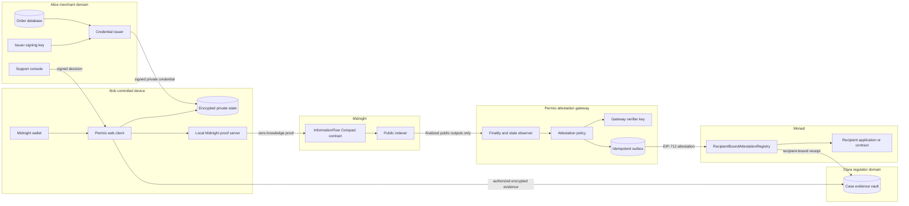
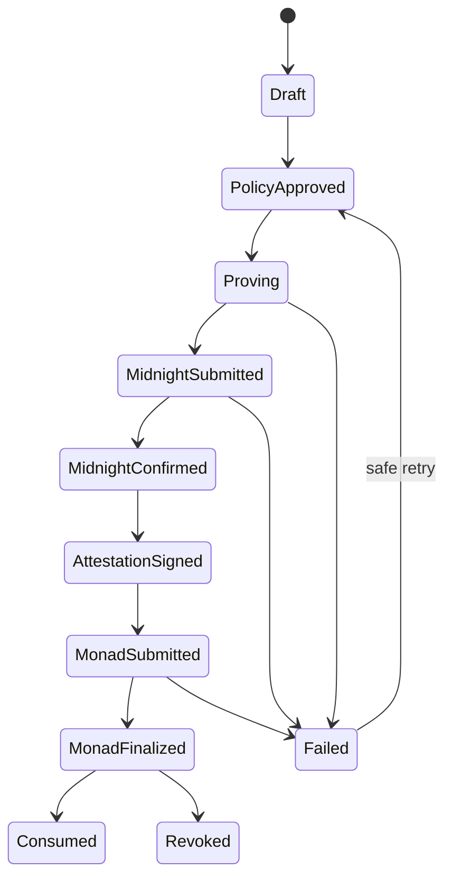

# Permio Alice Bob Clara Composite Architecture

Status: architecture decision and implementation plan  
Date: 9 October 2026  
Scope: Midnight privacy proofs plus Monad recipient-bound attestations

## 1 Decision

Permio will use a two-chain architecture with a deliberately narrow bridge:

- Midnight is the private credential, policy, and zero-knowledge execution layer.
- Monad is the public, EVM-composable trust-consumption layer.
- A gateway verifies finalized Midnight public outputs and signs an EIP-712
  attestation for one schema, purpose, recipient, and expiry window.
- A recipient or neutral relayer submits the attestation to Monad. Bob never
  needs to use a reusable Monad wallet.

The bridge is an MVP trust boundary, not a trustless light client. Monad trusts
an authorized gateway verifier key to have checked the correct Midnight network,
contract, transaction, and public state. That limitation must remain visible in
the product and demo.

The architecture deliberately does not publish the same generic
`InformationFlow` commitment on both chains. Monad receives a context-specific
receipt, not a duplicate timestamp. A public cross-chain reference proves that
one Monad receipt came from one Midnight action, but no field may link Bob's
review, support, and regulatory actions to each other.

## 2 Concrete scenario and actors

The first composite scenario uses the fixture already exercised by the Midnight
three-actor circuit test.

| Actor | Real-world role | Private authority | Public role |
| --- | --- | --- | --- |
| Alice | `Alice Audio`, merchant, issuer, and support decision maker | Issuer signing key, order record, support decision reason | Midnight issuer ID and public key; merchant application or support contract on Monad |
| Bob | Purchaser, reviewer, support claimant, and bridge authorizer | Purchase credential, holder secret, order ID, exact purchase date, selected evidence | Rating and review text; no public universal identity |
| Clara | Approved regulator and recipient of an escalation | Case workspace and any evidence Bob explicitly discloses | Recipient identifier on Midnight and recipient address or case contract on Monad |

These names are fixture labels, not protocol roles. The product must not encode
"Alice", "Bob", or "Clara" as a permanent identity class.

### Fixture values

| Field | Value | Classification |
| --- | --- | --- |
| Merchant | `alice-audio` | Public business identifier |
| Product | `H1` | Public product identifier |
| Order | `ORDER-BOB-001` | Private; disclosed only for fulfillment or authorized regulation |
| Credential | `CREDENTIAL-BOB-001` | Private |
| Holder secret | Bob-generated random secret | Private to Bob's wallet or vault |
| Review | Rating `4`; `Clear sound and comfortable fit.` | Public after Bob approves publication |
| Support case | `CASE-BOB-001` | Bob and Alice only until escalation |
| Support decision | Rejected; `Inspection evidence is required.` | Bob and Alice; committed on Midnight |
| Regulatory case | `REG-BOB-001` | Bob and Clara; Alice receives only the lawful dispute view |
| Regulatory purpose | `consumer complaint assessment` | Clara-visible and commitment-bound |

The proof establishes credential provenance, credential control, policy
eligibility, scoped uniqueness, selected-record integrity, and authorization.
It does not establish that Bob's opinion or allegation is true.

## 3 Chain and component responsibilities

| Component | Responsibility | Must not receive |
| --- | --- | --- |
| Bob client and Midnight private state | Hold credential and holder secret, preview disclosures, prepare proof calls | Alice issuer secret; gateway verifier key |
| Alice issuer service | Issue signed credentials and sign support decisions | Bob holder secret; Bob review identity |
| Local proof server | Build Midnight proofs for the calling client | Long-lived wallet or issuer private keys |
| Midnight Compact contract | Verify credential, policy, uniqueness, decisions, and case-bound bridges | Plain order ID, credential ID, holder secret, exact purchase date, review text, decision reason |
| Midnight public ledger | Store issuer keys, context nullifiers, action commitments, and counters | Private source records and cross-context universal identifiers |
| Permio gateway | Confirm Midnight network, contract, transaction, and public output; sign typed attestations | Credential, holder secret, plaintext order, review text, support reason |
| Monad registry | Verify gateway signature, recipient, purpose, expiry, and replay scope | Bob identity or any private Midnight input |
| Public application store | Serve Bob-approved review content and public metadata | Purchase credential, order, holder secret |
| Clara case vault | Store the evidence package Bob authorized for Clara | Other reviews, unrelated credentials, merchant-wide history |

Midnight's proof server sees witness data while generating a proof, so it must
run on Bob's controlled device or a trusted local environment. It is not a
generic hosted Permio service.

## 4 Composite topology



## 5 End-to-end information flow

### 5.1 Issuer registration

1. The contract authority approves Alice as credential issuer `issuerId = 1`.
2. Alice generates a dedicated Jubjub issuer key for Midnight credentials.
3. `registerCredentialIssuer` proves knowledge of the contract authority secret
   and writes Alice's issuer public key to Midnight public state.
4. The issuer secret remains in Alice's encrypted service keystore. It is not the
   Monad gateway verifier key and not the Monad relayer key.

Public result: issuer ID and issuer public key.  
Private result: Alice retains the issuer secret.

### 5.2 Purchase and private credential issuance

1. Alice records Bob's H1 purchase in her private order system.
2. Bob's client generates a fresh holder secret `s_B` and sends only its holder
   binding to Alice.
3. Alice signs a `PurchaseCredential` containing the issuer ID, merchant hash,
   product hash, purchase day, order hash, credential hash, and holder binding.
4. Bob stores the signed credential and `s_B` in encrypted account-scoped
   Midnight private state.

No blockchain transaction is required for every purchase. Midnight learns the
credential only as a private circuit input when Bob later uses it.

### 5.3 Reputation flow

1. Bob enters exactly two authored fields: rating and free-form review text.
2. The client shows a preview: public content, public metadata, public recipient,
   purpose, and all hidden fields.
3. Bob calls `publishReview` with the private credential, Alice's credential
   signature, and `s_B`.
4. The circuit verifies Alice's registered issuer key, signature, Bob's holder
   binding, rating range, and unused review nullifier.
5. Midnight discloses only `reviewNullifier` and `reviewCommitment` and updates
   public state.
6. The public review store saves rating, review text, merchant, product, and
   publication time. It can prove that these fields match the Midnight action
   commitment.
7. If an EVM review application needs composability, the gateway issues
   `PERMIO_REVIEW_ELIGIBLE_UNIQUE_V1` to that application contract on Monad.

The Monad receipt certifies eligibility and uniqueness. It does not certify the
truth of the review and contains no Bob address.

### 5.4 Support eligibility flow

1. Bob selects the H1 credential and requests replacement.
2. The client previews Alice as recipient and the predicates to reveal:
   Alice-issued credential, H1 product, purchase age at most 30 days, and unused
   support entitlement.
3. Bob calls `openSupportCase` with private credential data, `s_B`, current day,
   case commitment, remedy, policy version, and opening time.
4. Midnight verifies the credential, range rule, and context-specific support
   nullifier, then stores only the support nullifier and commitment.
5. The gateway waits for a stable Midnight result and signs
   `PERMIO_SUPPORT_ELIGIBLE_V1` for Alice's support address or contract.
6. A neutral relayer submits the attestation to Monad. Alice's support system
   calls `isValidFor` before opening or advancing the case.

This is the first production vertical slice because it gives both chains a
necessary and testable role with the smallest disclosure surface.

### 5.5 Alice's support decision

Alice signs a structured decision containing the support nullifier, support
commitment, outcome, reason commitment, decision timestamp, and policy version.

The current imported Midnight circuit should be revised before integration.
Today, `recordSupportDecision` requires Bob's full credential and holder secret
again. The target `recordSupportDecisionV2` instead accepts:

```text
issuerId
supportNullifier
supportCommitment
outcome
reasonCommitment
decidedAt
policyVersion
merchantSignature
```

The circuit will check that the support commitment already exists, verify the
decision signature against Alice's registered issuer key, prevent a second
decision for the same support nullifier, and publish only the decision
commitment. Alice therefore never needs Bob's holder secret.

### 5.6 Regulatory escalation flow

1. Bob selects the exact review snapshot, support case, and Alice decision.
2. The interface shows Clara, `REG-BOB-001`, the investigation purpose, policy
   version, selected records, newly created linkage, and expiry or case scope.
3. Bob explicitly authorizes the bridge.
4. `authorizeRegulatoryBridge` privately re-derives Bob's review and support
   nullifiers, checks the selected commitments and decision, and creates a
   bridge bound to Clara, the case, purpose, evidence set, and policy version.
5. Bob encrypts the selected plaintext evidence to Clara's case key. The ZK
   bridge proves linkage; it is not the transport for the plaintext evidence.
6. The gateway issues `PERMIO_REGULATORY_BRIDGE_V1` to Clara's Monad address or
   case contract.
7. Clara verifies the Midnight references, the Monad receipt, and the encrypted
   evidence. Alice receives no proof linking Bob to his public review unless a
   separate authorized rule explicitly permits that view.

## 6 ZK circuit design

`H` below is a protocol-defined Compact hash with explicit domain separation.
Every incompatible encoding change requires a new versioned domain.

### 6.1 Credential primitives

```text
holderBinding = H("permio:holder:v1", s_B)

credentialMessage = H(
  "permio:credential:v1",
  issuerId,
  merchantId,
  productId,
  purchaseDay,
  orderId,
  credentialId,
  holderBinding
)

credentialSignature = SchnorrSign(AliceIssuerSecret, credentialMessage)
```

### 6.2 Context-separated nullifiers and commitments

```text
N_review = H(
  "permio:review-nullifier:v1",
  s_B, credentialId, merchantId, productId
)

C_review = H(
  "permio:review-record:v1",
  merchantId, productId, N_review,
  rating, H("permio:review-text:v1", reviewText), publishedAt
)

N_support = H(
  "permio:support-nullifier:v1",
  s_B, credentialId, merchantId, productId
)

C_support = H(
  "permio:support-record:v1",
  merchantId, productId, N_support,
  caseId, requestedRemedy, policyVersion, openedAt
)

C_decision = H(
  "permio:support-decision:v2",
  N_support, C_support, outcome,
  reasonCommitment, decidedAt, policyVersion
)

evidenceSetHash = H(C_review, C_support, C_decision)

K_bridge = H(
  "permio:regulatory-bridge-key:v2",
  claraRecipientId, regulatorCaseId, purposeHash,
  evidenceSetHash, policyVersion
)

C_bridge = H(
  "permio:regulatory-bridge-record:v2",
  K_bridge, s_B, evidenceSetHash, authorizedAt, policyVersion
)
```

`N_review` and `N_support` must never be equal. `K_bridge` is recipient-, case-,
purpose-, evidence-, and policy-bound. The holder secret in `C_bridge` prevents
an observer from recomputing the cross-context linkage from public records.

### 6.3 Circuit catalogue

| Circuit | Private inputs | Public checks and state | Disclosed result |
| --- | --- | --- | --- |
| `registerCredentialIssuer` | Authority secret | Issuer ID unused; authority commitment matches | Issuer ID and public key |
| `publishReview` | Credential, issuer signature, holder secret | Issuer authorized; holder controls credential; rating 1-5; review scope unused | Review nullifier and commitment |
| `openSupportCase` | Credential, issuer signature, holder secret, purchase day | Purchase not in future; age <= 30 days; support scope unused | Support nullifier and commitment |
| `recordSupportDecisionV2` | Alice merchant signature; plaintext reason remains off-chain | Existing support commitment; issuer signature valid; no prior decision | Decision commitment |
| `authorizeRegulatoryBridgeV2` | Credential, signature, holder secret, selected record openings | All selected commitments exist and derive from the same credential; exact bridge key unused | Bridge key and commitment |

All exported values and ledger writes are intentional disclosures. Compact's
compiler must reject any witness-derived value that reaches public state without
an explicit disclosure.

## 7 Monad attestation design

The existing `RecipientBoundAttestationRegistry` remains the single Monad
contract for all three schemas.

```solidity
struct Attestation {
    bytes32 schemaId;
    bytes32 midnightNetworkIdHash;
    bytes32 midnightContractIdHash;
    bytes32 midnightTransactionIdHash;
    bytes32 actionCommitment;
    bytes32 scopedNullifier;
    bytes32 purposeHash;
    address recipient;
    uint64 issuedAt;
    uint64 expiresAt;
}
```

### 7.1 Schema registry

| Schema | Recipient | Recommended lifetime | Meaning |
| --- | --- | ---: | --- |
| `PERMIO_REVIEW_ELIGIBLE_UNIQUE_V1` | Review application contract | 365 days or product-defined | An eligible credential holder created one review in the defined scope |
| `PERMIO_SUPPORT_ELIGIBLE_V1` | Alice support contract or address | 15 minutes for consumption | The private purchase satisfies the current support policy |
| `PERMIO_REGULATORY_BRIDGE_V1` | Clara address or case contract | Case duration, capped by policy | The selected Midnight bridge is valid for this recipient, case, and purpose |

`schemaId` is the hash of the exact versioned schema string. `purposeHash` is a
hash of a canonical purpose, not arbitrary user text.

### 7.2 Relay nullifier

Monad must not copy the raw Midnight nullifier. The gateway derives a
chain-specific relay nullifier:

```text
N_monad = H(
  "permio:monad-relay:v1",
  midnightScopedNullifier,
  schemaId,
  purposeHash,
  recipient,
  monadChainId,
  registryAddress
)
```

This prevents the Monad value from becoming a reusable identifier on another
EVM chain or registry. The Midnight transaction reference still creates an
intentional link between one source action and one receipt. Hashing a public
transaction ID is provenance compression, not secrecy.

### 7.3 Submission and finality

- The gateway verifier key signs the EIP-712 payload but does not pay gas.
- A separate relayer or recipient submits the transaction.
- The UI may show a pending receipt after inclusion, but marks it final only
  after Monad `Finalized` status.
- An off-chain consumer making an irreversible financial decision should use
  the more conservative `Verified` state-root status.
- A duplicate registration is idempotent only when the existing attestation ID
  and all fields match; otherwise it is a replay failure.

## 8 Gateway validation and state machine

The gateway consumes only public Midnight data.

Validation sequence:

1. Match the configured Midnight network and exact contract address.
2. Fetch the transaction and contract state from the Midnight indexer.
3. Require the expected circuit action and stable confirmation.
4. Check that the returned nullifier or bridge key maps to the expected action
   commitment in contract state.
5. Apply the versioned schema policy and recipient allow-list.
6. Derive `N_monad`, build the EIP-712 payload, and sign it.
7. Persist the signed payload in an outbox before submission.
8. Submit through the relayer, wait for Monad finality, and record the receipt.



The outbox idempotency key is:

```text
H(midnightNetwork, midnightContract, midnightTxId,
  schemaId, purposeHash, recipient, registryAddress, monadChainId)
```

Private proof inputs are never serialized into the gateway job, logs, tracing,
error reports, or Monad submission.

## 9 Technology stack

### 9.1 Application and domain

- TypeScript with strict mode and Node.js 22.13 or newer.
- A modular monolith for the hackathon: web/API orchestration, policy, storage,
  and job state in one deployable application, with explicit interfaces for the
  proof client and attestation gateway.
- SQLite for local and demo persistence, with encrypted private columns and an
  append-only submission outbox.
- Web Crypto or Node crypto for SHA-256, AES-256-GCM, and local key wrapping.
- Vite for the browser bundle. Keep the current account-first interface and
  remove scenario-runner controls from the product UI.

### 9.2 Midnight

- Compact source compiled into generated contract, prover, verifier, and ZKIR
  artifacts. Generated output is compiler-managed and never edited manually.
- Midnight.js 4.1.x provider composition: encrypted account-scoped private
  state, indexer public data, ZK artifact provider, local proof provider,
  wallet provider, and transaction submission provider.
- Wallet SDK for a synchronized, DUST-capable wallet.
- Local development against Midnight Local Dev; shared demo against Preprod.
- Proof server on the user's controlled machine because it sees witness data.

### 9.3 Monad

- Solidity 0.8.31 targeting `evmVersion: "osaka"`.
- Hardhat 3 with Ignition deployments.
- `viem` 2.40 or newer for RPC, EIP-712 typing, events, and receipts.
- OpenZeppelin Contracts for `Ownable`, `EIP712`, and `ECDSA`.
- Monad Testnet for the hackathon; Monad Mainnet is explicitly out of MVP
  deployment scope.

### 9.4 Keys and roles

| Key | Holder | Capability | Separation requirement |
| --- | --- | --- | --- |
| Midnight contract authority | Deployment governance | Register issuer keys and future circuit governance | Not used for daily issuance or relay |
| Alice issuer key | Alice service | Sign purchase credentials and support decisions | Not used as Monad verifier or relayer |
| Bob holder secret | Bob private state | Prove credential control and derive scoped values | Never leaves Bob/proof boundary |
| Bob Midnight wallet | Bob wallet | Balance and submit Midnight transactions | Not an application subject identifier |
| Gateway verifier key | Permio gateway | Sign EIP-712 attestations | Cannot spend relayer funds or issue credentials |
| Monad relayer key | Relayer | Pay gas and submit attestations | Cannot create a valid attestation |
| Monad registry owner | Deployment governance or multisig | Rotate verifiers and administer contract | Separate from verifier and relayer |
| Clara case key | Clara | Decrypt the selected evidence package | Not used as a global customer identifier |

## 10 Network plan

| Stage | Midnight | Monad | Purpose |
| --- | --- | --- | --- |
| Unit and integration | Generated Compact runtime | Hardhat simulated network | Deterministic tests without wallets or external RPCs |
| Local end-to-end | Midnight Local Dev node, indexer, and proof server | Local Hardhat node | Full two-chain failure and retry testing |
| Hackathon demo | Midnight Preprod plus Bob-controlled proof server | Monad Testnet, chain ID 10143 | Public contract addresses and explorer-verifiable receipts |
| Future production | Midnight Mainnet with supported provider endpoints | Monad Mainnet, chain ID 143 | Outside the MVP; requires key governance, monitoring, and audit |

Public network endpoints are configuration, not protocol constants. They must be
read from environment-specific configuration and rechecked before deployment.

## 11 Target repository structure

Permio should become one npm-workspace monorepo while remaining a modular
monolith at runtime:

```text
Permio/
  apps/
    web/                       browser UI and disclosure previews
    api/                       sessions, policy, persistence, public API
  packages/
    domain/                    InformationFlow, canonicalization, commitments
    midnight-contracts/        Compact sources and compiler-managed output
    midnight-client/           adapters, wallet, providers, transaction service
    attestation-schema/        schema IDs, EIP-712 types, validation
    monad-contracts/           Solidity registry, tests, Ignition deployment
    gateway/                   Midnight observer, signer, outbox, Monad publisher
    fixtures/                  Alice Bob Clara deterministic test data
  test/
    privacy/
    cross-chain/
    live/
  docs/
  infra/
    local/                     local stack configuration without secrets
```

Until migration begins, the existing Solidity package may remain at repository
root. The first restructuring step should preserve its tests and Git history.

## 12 Threat model and controls

| Threat | Control | Required test |
| --- | --- | --- |
| Cross-context linkage | Separate nullifier domains; no Bob address on Monad; no shared generic commitment | Review and support receipts share no stable Bob-derived field |
| Recipient substitution | Recipient included in Midnight bridge, relay nullifier, and EIP-712 signature | Change recipient and signature verification fails |
| Purpose substitution | Canonical versioned purpose hash in both policy and signature | Change purpose and registration fails |
| Replay | Midnight nullifier maps plus Monad scope map and attestation ID | Second use fails on both chains |
| Gateway forgery | Authorized verifier allow-list, rotation, revocation, audit log | Unauthorized signer rejected |
| Gateway compromise | Separate verifier/relayer keys; short expiry; owner revocation | Revoked or expired receipt becomes invalid |
| Proof-server disclosure | Local controlled proof server; no hosted witness logging | Network/log inspection finds no private input outside local boundary |
| Merchant learns Bob's review | No review nullifier or review-to-Bob bridge in support view | Alice cannot correlate support case with public review |
| Content tampering | Versioned commitments for review text and decision reason | One-byte change breaks verification |
| Stale policy | Policy version committed in support, decision, and bridge | Mismatched policy version rejected |
| Finality race | Explicit Midnight confirmation and Monad Finalized/Verified states | UI does not mark final before configured threshold |
| Secret leakage | Redacted logs, ignored environment files, key-specific processes | Repository and API/DOM scans contain no secrets |

## 13 Acceptance tests for the three actors

1. Alice registers as issuer without gaining access to Bob's holder secret.
2. Alice signs one H1 credential; altering any credential field invalidates it.
3. Bob publishes one valid review; a second review in the same scope fails.
4. The public sees rating, text, verified status, and permitted metadata only.
5. Bob opens support within 30 days; the support nullifier differs from the
   review nullifier.
6. Alice verifies the support receipt but cannot identify Bob's public review.
7. Alice signs a decision without receiving Bob's holder secret.
8. Bob previews and authorizes a bridge for Clara and `REG-BOB-001`.
9. Clara verifies the exact review, support, decision, chronology, and bridge.
10. Reusing Clara's bridge for another address, case, purpose, or evidence set
    fails.
11. The gateway can create a Monad receipt from finalized public Midnight state
    without access to any witness input.
12. The Monad registry rejects an unauthorized signer, duplicate scope,
    recipient substitution, expiry, and revocation.
13. The relayer address is visible, but Bob has no Monad transaction or address
    in the workflow.
14. Restarting the application preserves prepared, submitted, and confirmed
    states and never resubmits a different attestation under the same idempotency
    key.

## 14 Current implementation and required changes

| Capability | Current location | Status | Next change |
| --- | --- | --- | --- |
| InformationFlow domain and application | `information-flow` repository | Implemented | Port selected modules after architecture interfaces stabilize |
| Three-actor Midnight circuits | `information-flow/contracts/information-flow.compact` | Implemented and locally tested | Create V2 decision and bridge domains; rerun full Compact checks |
| Midnight transaction service and gateway | `information-flow/src` | Implemented | Add durable outbox and public-output observer contract |
| Recipient-bound Monad registry | `Permio/contracts` | Implemented and tested | Add versioned schema package and publisher |
| Cross-chain gateway | Not implemented | Missing | Build read-only Midnight verifier, EIP-712 signer, and Monad publisher |
| Dual-chain end-to-end test | Not implemented | Missing | Add local Midnight plus Hardhat test, then Preprod plus Testnet smoke test |
| Product UI integration | `information-flow/web` | Partially implemented | Port preview and lifecycle UI; show both chain receipts and trust label |

## 15 Delivery sequence

1. Freeze the three schema IDs, purpose vocabulary, canonical encodings, and
   V2 circuit domains in tests.
2. Refactor `recordSupportDecisionV2` so Alice does not need Bob's secret.
3. Port the Midnight contract, adapters, transaction service, and three-actor
   tests into the Permio workspace layout.
4. Implement the support-only gateway path and durable outbox.
5. Run a local dual-chain test: Midnight Local Dev proof to Hardhat registry.
6. Deploy the registry to Monad Testnet and the Compact contract to Midnight
   Preprod; record addresses and compiler versions.
7. Complete the support demo, including recipient substitution and replay
   failures.
8. Add review and regulatory schemas through the same registry and gateway.
9. Port the account-first UI and add explicit disclosure previews and two-chain
   lifecycle receipts.
10. Perform privacy, key-separation, restart, and live-chain acceptance tests.

## 16 Official references

- [Midnight private contract guide](https://docs.midnight.network/guides/build-a-private-smart-contract)
- [Midnight deployment and provider guide](https://docs.midnight.network/guides/deploy-and-operate)
- [Midnight environments and endpoints](https://docs.midnight.network/relnotes/network)
- [Midnight.js API](https://docs.midnight.network/api-reference/midnight-js)
- [Monad deployment summary](https://docs.monad.xyz/developer-essentials/summary)
- [Monad Hardhat deployment guide](https://docs.monad.xyz/guides/deploy-smart-contract/hardhat)
- [Monad Testnet information](https://docs.monad.xyz/developer-essentials/testnet)

---

# Permio Alice Bob Clara 复合架构

状态：架构决策与实施计划  
日期：2026 年 10 月 9 日  
范围：Midnight 隐私证明与 Monad 接收方绑定证明

## 1 架构决策

Permio 采用双链架构，并使用一个范围严格受限的桥接层：Midnight 是私有凭证、策略和
零知识执行层；Monad 是公开且可由 EVM 应用组合使用的信任消费层；网关只验证已经最终
确认的 Midnight 公开输出，并为一个模式、用途、接收方和有效期签署 EIP-712 证明；
接收方或中立中继器把证明提交到 Monad，Bob 不需要使用可重复识别的 Monad 钱包。

该桥接是 MVP 的明确信任边界，不是无需信任的轻客户端。Monad 信任获授权的网关验证者
已经检查了正确的 Midnight 网络、合约、交易和公开状态。产品与演示必须准确展示这一限制。

系统不会把同一个通用 `InformationFlow` 承诺同时发布到两条链。Monad 收到的是特定
上下文的收据，而不是重复时间戳。一条公开跨链引用可以证明某个 Monad 收据来自某个
Midnight 动作，但任何字段都不得把 Bob 的评价、客服和监管动作彼此关联起来。

## 2 具体场景与角色

Alice 代表 `Alice Audio`，是商家、购买凭证签发者和客服决定者；Bob 是购买者、评价者、
客服申请者和监管桥接授权者；Clara 是获批准的监管接收方。这些名字只是测试标签，不是
协议中的永久身份类别。

Alice 持有签发密钥、订单记录和客服决定原因；Bob 持有购买凭证、持有人秘密、订单号、
精确购买日期和他选择的证据；Clara 持有案件工作区以及 Bob 明确披露的材料。公开数据只
包括 Alice 的 Midnight 签发者 ID 与公钥、Bob 主动公开的评分和评价文本，以及 Clara
在监管桥接中的接收方标识。系统绝不创建 Bob 的全局公开身份。

固定场景使用 `alice-audio`、产品 `H1`、私有订单 `ORDER-BOB-001`、私有凭证
`CREDENTIAL-BOB-001`、评分 `4`、评价文本 `Clear sound and comfortable fit.`、
客服案件 `CASE-BOB-001`、拒绝理由 `Inspection evidence is required.`、监管案件
`REG-BOB-001` 和用途 `consumer complaint assessment`。

证明只建立凭证来源、凭证控制权、策略资格、限定范围的唯一性、所选记录完整性和授权，
不证明 Bob 的观点或指控为真。

## 3 组件职责与隐私边界

Bob 的客户端和 Midnight 私有状态保存凭证与持有人秘密、预览披露并准备证明调用。Alice
的签发服务签署购买凭证与客服决定，但不能接收 Bob 的持有人秘密或评价身份。本地证明
服务器为调用者生成 Midnight 证明；它会看到 witness 数据，因此必须运行在 Bob 控制的
设备或可信本地环境中，不能成为普通托管的 Permio 服务。

Midnight Compact 合约验证凭证、策略、唯一性、客服决定和案件绑定桥接。公开账本只存储
签发者公钥、上下文限定的空值标识、动作承诺和计数器，不存储明文订单号、凭证号、持有人
秘密、精确购买日期、评价文本或客服理由。

Permio 网关只读取已确认的 Midnight 公开数据，核对网络、合约、交易和公开状态，然后
签署类型化证明。Monad 注册表验证网关签名、接收方、用途、有效期和防重放范围，不能接收
Bob 的身份或任何 Midnight 私有输入。Clara 的案件保险库只保存 Bob 为该案件授权的加密
证据，不得获得其他评价、无关凭证或商家完整历史。

## 4 完整信息流

### 4.1 签发者注册与购买凭证

合约治理方批准 Alice 成为 `issuerId = 1` 的凭证签发者，并把她的 Jubjub 公钥登记到
Midnight 公开状态。Alice 的签发私钥保存在加密服务密钥库中，不得与 Monad 网关验证者
密钥或中继器密钥复用。

Bob 的客户端生成新的持有人秘密 `s_B`，只把持有人绑定值发送给 Alice。Alice 对包含
签发者 ID、商家哈希、产品哈希、购买日、订单哈希、凭证哈希和持有人绑定值的
`PurchaseCredential` 签名。Bob 将签名凭证和 `s_B` 存入按账户隔离的加密 Midnight
私有状态。每笔购买不需要立即写链；只有 Bob 使用凭证时，凭证才作为私有电路输入出现。

### 4.2 评价流程

Bob 只填写评分和自由文本两个字段，并在提交前看到公开内容、元数据、接收方、用途和所有
隐藏字段。`publishReview` 使用私有凭证、Alice 的签名和 `s_B` 验证签发者、持有人控制权、
评分范围和未使用的评价空值标识。Midnight 只公开 `reviewNullifier` 与
`reviewCommitment`。公共评价存储保存 Bob 已批准公开的评分、文本、商家、产品和时间。

如果 EVM 评价应用需要组合使用该事实，网关向该应用合约签发
`PERMIO_REVIEW_ELIGIBLE_UNIQUE_V1`。Monad 收据只证明资格与唯一性，不证明评价内容
真实，也不包含 Bob 地址。

### 4.3 客服资格流程

Bob 选择 H1 凭证并请求换货。界面预览 Alice 是接收方，并只披露以下谓词：凭证由 Alice
签发、产品为 H1、购买不超过 30 天、客服权益未使用。`openSupportCase` 使用私有凭证、
`s_B`、当前日期、案件承诺、补救方式、策略版本和开启时间。Midnight 验证规则后只保存
客服空值标识和承诺。

网关等待 Midnight 结果稳定后，为 Alice 的客服地址或合约签署
`PERMIO_SUPPORT_ELIGIBLE_V1`。中立中继器将证明提交到 Monad，Alice 的客服系统在
创建或推进案件前调用 `isValidFor`。这是第一条生产纵向切片，因为它以最小披露面积为
两条链提供了不可替代且可测试的职责。

### 4.4 Alice 的客服决定

Alice 对客服空值标识、客服承诺、结果、理由承诺、决定时间和策略版本组成的结构化决定
签名。当前 Midnight 电路要求再次提供 Bob 的完整凭证和持有人秘密，集成前必须修正。

目标 `recordSupportDecisionV2` 只接收签发者 ID、客服空值标识、客服承诺、结果、理由
承诺、决定时间、策略版本和 Alice 的签名。电路检查客服承诺已经存在，用 Alice 登记的
签发者公钥验证决定签名，阻止同一客服空值标识的第二个决定，并只公开决定承诺。因此
Alice 永远不需要 Bob 的持有人秘密。

### 4.5 监管升级流程

Bob 选择精确的评价快照、客服案件和 Alice 的决定。界面显示 Clara、`REG-BOB-001`、
调查用途、策略版本、所选记录、新建关联以及过期或案件范围。Bob 明确授权后，
`authorizeRegulatoryBridgeV2` 私下重新派生评价和客服空值标识，核对所选承诺与决定，
并生成绑定 Clara、案件、用途、证据集合和策略版本的桥接。

Bob 使用 Clara 的案件密钥加密所选明文证据。ZK 桥接证明关联关系，但不负责传输明文。
网关向 Clara 的 Monad 地址或案件合约签发 `PERMIO_REGULATORY_BRIDGE_V1`。Clara 验证
Midnight 引用、Monad 收据和加密证据。除非另有一条独立且明确授权的规则允许，Alice
不会获得把 Bob 与公开评价关联起来的证明。

## 5 ZK 电路设计

所有哈希都使用具有显式域分离的版本化 Compact 协议编码。持有人绑定为
`H("permio:holder:v1", s_B)`。评价空值标识使用评价专用域以及 `s_B`、凭证 ID、商家和
产品；客服空值标识使用不同的客服专用域和相同私有来源，因此两者绝不能相等。

评价承诺绑定商家、产品、评价空值标识、评分、评价文本哈希和发布时间。客服承诺绑定商家、
产品、客服空值标识、案件、补救方式、策略版本和开启时间。客服决定承诺绑定客服空值标识、
客服承诺、结果、理由承诺、决定时间和策略版本。

证据集合哈希绑定评价、客服和决定承诺。桥接键使用 V2 域并绑定 Clara、监管案件、用途、
证据集合和策略版本；桥接承诺还包含 Bob 的持有人秘密，使公开观察者无法从公开记录重新
计算跨上下文关联。

电路目录包括：登记签发者的 `registerCredentialIssuer`；验证签发者、持有人控制权、评分
和一次性评价的 `publishReview`；验证 30 天规则与一次性客服权益的 `openSupportCase`；
不再需要 Bob 秘密的 `recordSupportDecisionV2`；以及验证同一凭证、精确证据集合和指定
接收方的 `authorizeRegulatoryBridgeV2`。所有导出返回值和账本写入都必须是明确披露。

## 6 Monad 证明设计

现有 `RecipientBoundAttestationRegistry` 继续作为三个模式共用的唯一 Monad 合约。
EIP-712 载荷绑定模式 ID、Midnight 网络/合约/交易引用哈希、动作承诺、限定范围空值标识、
用途哈希、接收方、签发时间和过期时间。EIP-712 域还绑定 Monad 链 ID 和注册表地址。

评价模式的接收方是评价应用合约，建议有效期为一年或由产品策略决定；客服模式的接收方是
Alice 的客服合约或地址，建议使用 15 分钟的消费窗口；监管模式的接收方是 Clara 的地址
或案件合约，有效期受案件策略约束。

Monad 不直接复制 Midnight 原始空值标识。网关以 Midnight 空值标识、模式、用途、接收方、
Monad 链 ID 和注册表地址派生链专用 `N_monad`。这样该值不能在另一个 EVM 链或注册表中
复用。Midnight 交易引用仍然有意建立一个来源动作与一个收据之间的关联；对公开交易 ID
做哈希只是压缩来源，不提供保密性。

网关验证者密钥只签名，不支付 gas；独立中继器或接收方提交交易。界面可在交易被包含后
显示等待状态，但只能在 Monad 达到 `Finalized` 后标记完成。会据此执行不可逆财务操作的
链下消费者应等待更保守的 `Verified` 状态根确认。

## 7 网关与状态机

网关依次核对 Midnight 网络和合约地址、获取交易与合约状态、确认预期电路动作与稳定状态、
验证空值标识或桥接键映射到正确承诺、应用版本化模式策略和接收方白名单、派生
`N_monad`、签署 EIP-712、先写入幂等 outbox，再提交到 Monad 并等待最终确认。

生命周期为：草稿、策略批准、证明中、Midnight 已提交、Midnight 已确认、证明已签署、
Monad 已提交、Monad 已最终确认、已消费或已撤销。证明、Midnight 提交和 Monad 提交失败
可以从安全检查点重试。幂等键绑定 Midnight 网络、合约、交易、模式、用途、接收方、
Monad 注册表和链 ID。

任何私有证明输入都不得序列化进网关任务、日志、链路追踪、错误报告或 Monad 交易。

## 8 技术栈与链

应用层使用严格模式 TypeScript 与 Node.js 22.13 以上版本。黑客松阶段采用模块化单体：
Web/API 编排、策略、存储和任务状态属于一个可部署应用，但证明客户端和证明网关之间使用
明确接口。SQLite 用于本地与演示持久化，私有列加密，并使用只追加提交 outbox。浏览器
使用 Vite，保留账户优先界面，不在产品 UI 中恢复场景运行器。

Midnight 使用 Compact 源码以及编译器生成的 contract、prover、verifier 和 ZKIR 产物；
生成目录不得手工编辑。Midnight.js 4.1.x 组合按账户隔离的加密私有状态、Indexer、ZK
产物提供器、本地证明提供器、钱包和交易提交能力。钱包必须同步并具备 DUST。开发使用
Midnight Local Dev，公开演示使用 Preprod，并始终把证明服务器放在用户控制环境中。

Monad 使用 Solidity 0.8.31、`evmVersion: "osaka"`、Hardhat 3、Ignition、`viem >= 2.40`
和 OpenZeppelin Contracts。黑客松部署目标是链 ID `10143` 的 Monad Testnet；链 ID
`143` 的 Monad Mainnet 明确不属于 MVP 部署范围。

环境矩阵为：单元测试使用生成的 Compact runtime 与 Hardhat 模拟链；本地端到端使用
Midnight Local Dev 与本地 Hardhat 节点；黑客松演示使用 Midnight Preprod、Bob 控制的
证明服务器和 Monad Testnet；未来生产环境才考虑 Midnight Mainnet 与 Monad Mainnet。
公开 RPC 端点属于配置而不是协议常量，部署前必须重新核对。

## 9 密钥分离

Midnight 合约治理密钥只登记签发者和执行未来治理；Alice 签发密钥只签署购买凭证和客服
决定；Bob 持有人秘密只用于证明控制权和派生限定范围值；Bob 的 Midnight 钱包只平衡与
提交 Midnight 交易，不能成为产品中的主体标识；网关验证者密钥只签署 EIP-712；Monad
中继器密钥只支付 gas；Monad 注册表所有者负责轮换验证者；Clara 案件密钥只解密选定证据。
这些密钥不得复用。

## 10 目标仓库结构

Permio 最终成为一个 npm workspace 单仓库，包含 `apps/web`、`apps/api`、领域包、Midnight
合约包与客户端包、证明模式包、Monad 合约包、网关包、固定测试数据、隐私/跨链/实时测试
以及本地基础设施配置。运行时仍保持模块化单体，仅把具有独立密钥和信任边界的网关作为
可分离进程。

在正式迁移之前，现有 Solidity 包可以继续位于仓库根目录。第一次目录重构必须保留测试
和 Git 历史。

## 11 安全控制与验收

系统必须通过以下核心验收：评价与客服证明没有稳定的 Bob 派生公共字段；更换接收方、用途、
案件或证据集合会使验证失败；两条链都阻止重复使用；未授权网关签名被拒绝；过期或撤销的
Monad 收据无效；证明服务器之外的网络与日志中不出现私有输入；Alice 无法把 Bob 的客服
案件与公开评价关联；修改评价或决定内容会破坏承诺；策略版本不匹配会被拒绝；界面不会在
配置的最终性阈值之前显示完成；仓库、API 和 DOM 不包含秘密。

三角色旅程的完成条件是：Alice 注册签发者并签发 H1 凭证；Bob 成功发布一次评价且重复
评价失败；Bob 在 30 天内开启客服且客服空值标识不同于评价空值标识；Alice 在不获得 Bob
秘密的情况下签署决定；Bob 预览并授权 Clara 的监管桥接；Clara 验证精确的评价、客服、
决定、时间顺序和桥接；网关只根据已最终确认的 Midnight 公开状态创建 Monad 收据；Monad
拒绝未授权签名、重复范围、接收方替换、过期和撤销；Bob 在整个流程中没有 Monad 交易或
地址；应用重启后仍能安全恢复全部提交状态。

## 12 当前状态与交付顺序

旧 `information-flow` 仓库已经实现领域模型、三角色 Midnight 电路、适配器、交易服务和
部分产品 UI。新的 Permio 仓库已经实现并测试 Monad 的接收方绑定注册表。缺少的是实际
跨链网关、持久化 outbox、双链端到端测试和整合后的产品界面。

实施顺序为：先冻结三个模式 ID、用途词汇、规范编码和 V2 电路域；重构
`recordSupportDecisionV2`；把必要 Midnight 模块和三角色测试迁入 Permio；实现仅客服
场景的网关与 outbox；完成 Midnight Local Dev 到 Hardhat 的双链测试；把 Monad 合约部署
到 Testnet、Compact 合约部署到 Preprod；完成客服演示和失败路径；再通过同一注册表添加
评价与监管模式；最后迁移账户优先 UI，并完成隐私、密钥分离、重启恢复和实时链验收。

## 13 官方参考

- [Midnight 私有合约指南](https://docs.midnight.network/guides/build-a-private-smart-contract)
- [Midnight 部署和提供器指南](https://docs.midnight.network/guides/deploy-and-operate)
- [Midnight 环境与端点](https://docs.midnight.network/relnotes/network)
- [Midnight.js API](https://docs.midnight.network/api-reference/midnight-js)
- [Monad 部署摘要](https://docs.monad.xyz/developer-essentials/summary)
- [Monad Hardhat 部署指南](https://docs.monad.xyz/guides/deploy-smart-contract/hardhat)
- [Monad Testnet 信息](https://docs.monad.xyz/developer-essentials/testnet)
