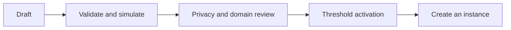
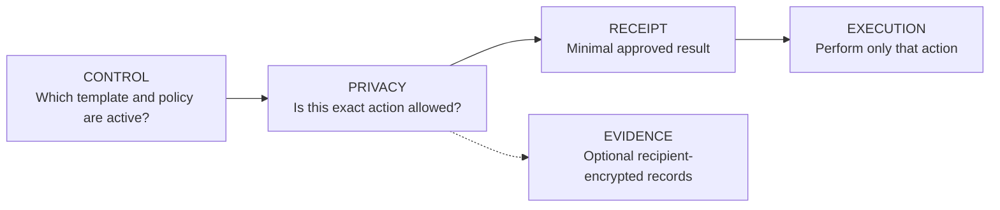
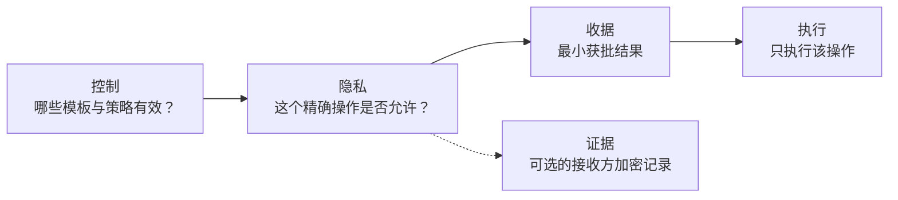

# Permio: From Human Need to Programmable Context

Status: human-first product and architecture guide<br>
Date: 11 October 2026

## 1 Start with the human problem

People disclose information because a relationship requires it. A patient
shares a test with a specialist. A worker proves a qualification to a site. A
person lets an automated agent make a bounded payment. The information may be
appropriate in that relationship and inappropriate everywhere else.

Traditional platforms can implement access rules, but they usually accumulate
the identity graph, raw records, policy logic, execution power, and audit trail
in one operator. The user has to trust that operator not to widen a purpose,
reuse an identifier, retain unnecessary data, or silently change the rule.

Decentralization is useful here when it separates those powers. A private proof
system can check a rule without publishing the source record. A public
execution system can consume a narrow result without learning the evidence. An
independent recipient can verify what was authorized. No single component
needs the whole relationship graph.

Permio is therefore not “a decentralized version” of one application. It is
infrastructure for making information-use permissions explicit, narrow,
verifiable, and reusable across different products.

## 2 The central idea: context changes what is appropriate

Privacy is not only secrecy. The same fact can be appropriate for one
recipient, purpose, and period but inappropriate for another. A context must
therefore define:

- who is participating and in what relationship;
- which records may support an action;
- which claims may be derived;
- who may receive those claims;
- the permitted purpose and time window;
- whether delegation is allowed;
- what happens when information crosses into another context; and
- which public effect may follow an approved decision.

Logging in is not enough. A valid account may still be unauthorized for the
selected action, case, purpose, or recipient.

## 3 The example is not the product

Earlier designs followed one named purchase journey. That was useful for
learning, but it accidentally made the test story look like the architecture.
Permio now separates five levels:

1. A `ScenarioTemplate` defines reusable roles-as-slots, contexts, actions,
   transitions, disclosures, proofs, and execution adapters.
2. A `ScenarioInstance` binds an approved template version to real principals
   and current state.
3. A `ContextAccount` represents one principal only inside that instance or
   context.
4. A `CapabilityGrant` authorizes an exact action, resource, purpose,
   recipient, time, and delegation limit.
5. An `InformationFlow` records one evaluated action inside the instance.

Concrete names, records, identifiers, amounts, and timestamps belong to a
generated or real scenario instance. They do not belong in architecture,
contracts, or hand-written acceptance criteria.

## 4 How a scenario enters the library



A human, organization, or Agent may draft a template if it holds an authoring
capability. Deterministic tools check its schema, referenced circuits,
conflicting rules, privacy invariants, and tests. Named reviewers examine what
can be disclosed and how contexts connect. Namespace governance activates one
exact version and content hash. A runtime allocator may then instantiate it.

An Agent can draft, test, and flag risks. It cannot approve its own policy.
The party allowed to instantiate a template is also not automatically allowed
to assign every slot or delegate every action.

### 4.1 Who actually programs the system

There is no single programmer role. A template author writes declarative data:
slots, contexts, actions, transitions, constraints, and references to already
approved proof profiles and execution adapters. The template cannot contain or
download executable code. Reviewers attest to its exact hash and version;
threshold namespace governance activates it; an allocator creates instances.

Executable privacy logic follows a separate release path. Circuit maintainers
write and compile proof logic, clients or approved provers generate proofs, and
Midnight verifies authorization. Executable public effects follow another
release path: adapter developers implement them in a Monad contract or ordinary
application, and execution governance controls deployment. The gateway only
transports a finalized decision receipt; it does not run private policy.

For a high-assurance end-to-end test, task participants are generated slot
occupants rather than system roles. Outside those participants, the test uses a
separate template author, privacy reviewer, security reviewer, domain reviewer,
three namespace signers with a two-of-three threshold, allocator, emergency
revoker, gateway signer, execution-registry governor, and relayer. Issuer and
evidence-vault identities appear only when the selected template requires
them. The full normative matrix is in the architecture document.

## 5 How programmable permissions feel to a user

A person does not receive a permanent “patient,” “worker,” “buyer,” or “agent
owner” role. The interface presents a proposed action in plain language:

- what will happen;
- which context and scenario instance it belongs to;
- which records will be used privately;
- which claims will be revealed;
- who receives the result;
- why they receive it;
- how long the permission lasts;
- whether an Agent or service may act; and
- which new link, if any, the action creates.

After confirmation, the client creates an `ActionIntent`. A short-lived session
key may exercise only the listed capability. Changing the recipient, purpose,
resource, time, or action requires a different authorization.

## 6 Three first-class scenario profiles

These template families are part of the Permio design, not optional future
examples and not fixed fixtures. Concrete values are generated only when a
template is instantiated.

### 6.1 Clinical referral and research consent

A patient wants a specialist to see selected observations for treatment during
a limited period. The specialist does not need the patient's complete record.
Later, a research service asks whether the patient meets a study criterion.
That is a new context and should reveal an eligibility claim rather than the
treatment record or specialist relationship.

The template must distinguish treatment, research, and optional emergency
access; bind each to its own recipient, purpose, period, and audit rule; and
allow consent to expire or be revoked. HL7 FHIR Consent is relevant because it
models recipients, actions, purposes, data, periods, and computable consent
rules.

### 6.2 Professional qualification and temporary site access

A professional needs to prove that one qualification is current for a specific
task, site, and shift. The site does not need the person's full transcript,
home address, unrelated certificates, or employment history. A successful
proof creates a short-lived access capability.

If an incident later requires investigation, selected evidence moves into a
new investigator context through an explicit bridge. The original site-access
presentation must not become a reusable identifier. W3C Verifiable Credentials
research is relevant because it covers professional and education credentials,
holder-controlled disclosure, duration limits, revocation, and correlation
risks.

### 6.3 Delegated financial or purchasing Agent

A person wants an automated Agent to complete a named transaction for a named
counterparty under a bounded amount or resource policy and before an expiry.
The Agent should not see unrelated account history, change the recipient,
delegate indefinitely, activate policies, or reuse permission after revocation.

The privacy layer approves the precise intent; the high-throughput layer
executes it. OAuth Rich Authorization Requests is relevant because it uses
structured authorization details rather than one broad scope string. ODRL is
relevant as a vocabulary for parties, actions, assets, constraints, and duties.

## 7 The system in one picture



- The **control plane** governs versions, reviewers, issuers, and upgrades.
- **Midnight** checks private evidence, capability scope, context, expiry, and
  uniqueness.
- A **gateway** verifies finalized public output and transports a typed receipt.
- **Monad or an application** checks the receipt and performs the named action.
- An **evidence vault** receives selected ciphertext directly when necessary.

The execution layer may reject a receipt because execution state has changed.
It may never broaden what the privacy layer approved.

### 7.1 What Midnight stores and what remains private

Permio uses four mechanisms for four different jobs. Active template versions,
their exact content hashes, lifecycle, and approved proof-module versions are
direct public Midnight records because they are shared governance facts.
Versioned Merkle roots represent eligible namespace authority keys and the
current active/revoked status of private context accounts, capabilities, and
sessions. Individual allocations, grants, sessions, and action intents remain
private signed assertions checked inside runtime proofs. M4 reviewer approvals
remain off-chain Ed25519 evidence committed by the activation-admission
envelope. Private instance state remains hidden behind a public state
commitment and sequence; scoped nullifiers prevent the same action
authorization from being consumed twice.

M4 verifies eligible unique reviewers, namespace thresholds, rejection state,
and separation of duties. The namespace governance/activation authority then
signs one exact, replay-protected envelope with the allowlisted Midnight
Jubjub/Schnorr admission profile. Midnight verifies that currently eligible
authority and records only the exact template version and hash. It does not
claim to have independently re-verified each Ed25519 reviewer signature.

A template may select and configure only an exact active module from the
allowlisted proof-module registry. It cannot contain executable proof logic or
request `latest`. If no approved module implements the required claim, template
activation stops with `UNSUPPORTED_PROOF_REQUIREMENT`; adding that proof family
requires an independently reviewed and governed protocol upgrade.

For a template-declared state transition, Midnight verifies the current state
commitment and sequence and atomically installs the next commitment, increments
the sequence, and consumes the nullifier. This orders privacy-authorization
state. It does not claim that Monad or another application successfully
performed the downstream action.

## 8 What “Contract Authority” means

The smart contract is an automated enforcer, not a human manager. It checks
proofs, signatures, thresholds, timelocks, and state. Accountable governance
controllers decide which issuer, template, circuit, verifier, upgrade, or
emergency action should be authorized.

Those powers must be separated. Template activation, issuer admission, circuit
upgrades, gateway rotation, execution-registry administration, and emergency
revocation use different capabilities and preferably different threshold keys.
A single authority secret is acceptable only as a labelled local-development
bootstrap mechanism.

## 9 What the system proves—and what it does not

Depending on the selected template and circuit, a proof may establish:

- credential provenance and current status;
- control of a credential or context account;
- satisfaction of a policy predicate;
- authorization for one recipient, purpose, action, and period;
- scoped uniqueness or non-reuse; and
- integrity of selected records and transitions.

It does not automatically prove that an opinion, allegation, diagnosis,
prediction, or human decision is true. It also does not make an unsafe scenario
template safe. Template review and governance remain essential.

## 10 How examples and tests are produced

Architecture defines schemas and invariants. A versioned generator produces
synthetic scenario instances from an explicit seed:

```text
template + generator version + seed + policy profile
  -> synthetic principals and records
  -> expected private/public classification
  -> positive and negative tests
```

The same generator can produce a readable demonstration, a deterministic test
fixture, or randomized property tests. Changing a generated name or identifier
must not require source-code changes. Production data never uses test seeds.

For M6 engineering, the sibling `information-flow` repository is a reference
for Midnight integration mechanics, not a Permio application template or code
dependency. Its resumable wallet synchronization, Compact compilation,
deployment/reconnect, local proof-server configuration, redaction, and
public-only evidence patterns may be studied and deliberately adapted. Its
domain model, contract state, named actors, keys, checkpoints, and deployed
addresses are not copied into Permio.

The shared workspace already retains three synchronized disposable Preprod
account checkpoints and a ledger-8 local proof server, avoiding unnecessary
full-history synchronization during later opt-in smoke tests. Wallet secrets
and checkpoints remain ignored and privacy-sensitive. M6 completion still
requires a fresh, recorded test against the pinned Local Dev node, indexer, and
proof server; the reusable Preprod accounts do not replace that exit gate.

## 11 Research references

- [HL7 FHIR Consent](https://hl7.org/fhir/consent.html)
- [W3C Verifiable Credentials Use Cases](https://www.w3.org/TR/vc-use-cases/)
- [W3C Verifiable Credentials Data Model 2.0](https://www.w3.org/TR/vc-data-model-2.0/)
- [RFC 9396: OAuth 2.0 Rich Authorization Requests](https://www.rfc-editor.org/rfc/rfc9396.html)
- [W3C ODRL Information Model 2.2](https://www.w3.org/TR/odrl-model/)

These sources help define Permio's first profiles. Using their external data
formats or libraries still requires an explicit compatibility, security,
privacy, and licensing decision.

---

# Permio：从人的需求到可编程情境

状态：面向人的产品与架构指南<br>
日期：2026 年 10 月 11 日

## 1 从人的问题开始

人们披露信息，是因为某种关系需要它。患者把检查结果交给专科人员；工作人员向场地证明
资格；一个人允许自动化 Agent 执行有限范围的付款。信息在该关系中可能合理，到了其他地方
却可能不合理。

传统平台当然可以实现访问规则，但通常会把身份关系图、原始记录、策略逻辑、执行权和审计
轨迹集中到一个运营方。用户只能相信它不会扩大用途、复用标识符、保留不必要数据或悄悄改变
规则。

去中心化在这里的价值是拆分这些权力。私有证明系统可以在不发布来源记录的情况下检查规则；
公开执行系统可以在不了解证据的情况下消费一个狭窄结果；独立接收方可以验证究竟授权了什么。
没有任何单一组件需要掌握完整关系图。

因此，Permio 不是某一个应用的“去中心化版本”。它是一套让信息使用权限变得显式、狭窄、
可验证，并能够在不同产品中复用的基础设施。

## 2 核心思想：上下文决定什么是合理的信息流

隐私不只是保密。同一事实对于某个接收方、用途和期限可能合理，对于另一个则不合理。因此，
一个上下文必须定义：

- 谁参与，以及他们处于什么关系；
- 哪些记录可以支持操作；
- 可以派生哪些声明；
- 谁可以接收这些声明；
- 允许的用途与时间窗口；
- 是否允许委托；
- 信息跨入另一个上下文时会发生什么；以及
- 获批准决定可以触发什么公开效果。

登录并不等于授权。有效账户仍可能没有权限执行所选操作、处理所选案件、使用某个用途或向
某个接收方披露。

## 3 示例不是产品

早期设计沿着一个具名购买旅程展开。它有助于学习，却也意外地让测试故事看起来像架构本身。
Permio 现在把五个层次分开：

1. `ScenarioTemplate` 定义可复用的角色槽位、上下文、操作、转换、披露、证明和执行适配器。
2. `ScenarioInstance` 把一个已批准模板版本绑定到真实主体和当前状态。
3. `ContextAccount` 只在该实例或上下文内表示一个主体。
4. `CapabilityGrant` 授权精确操作、资源、用途、接收方、时间与委托限制。
5. `InformationFlow` 记录实例内一次经过评估的操作。

具体姓名、记录、标识符、金额和时间戳属于生成的或真实的情境实例，不属于架构、合约或
手写验收条件。

## 4 情境如何进入情境库


持有作者能力的人、组织或 Agent 可以草拟模板。确定性工具检查模式、引用电路、冲突规则、
隐私不变量和测试。具名审核者检查哪些内容可以披露以及上下文如何连接。命名空间治理激活一个
精确版本与内容哈希。之后，运行时分配器才能实例化它。

Agent 可以草拟、测试和标记风险，但不能批准自己的策略。能够实例化模板的一方，也不会自动
获得分配所有槽位或委托所有操作的权限。

### 4.1 到底是谁在编程系统

系统不存在单一程序员角色。模板作者编写的是声明式数据：槽位、上下文、操作、转换、约束，
以及对已获批准的证明配置和执行适配器的引用。模板不能包含或下载可执行代码。审核者为模板的
精确哈希和版本背书；阈值命名空间治理方激活模板；分配者创建实例。

可执行隐私逻辑使用另一条发布路径。电路维护者编写并编译证明逻辑，客户端或获批证明服务生成
证明，Midnight 验证授权。可执行公开效果又使用独立发布路径：适配器开发者在 Monad 合约或
普通应用中实现公开效果，执行治理方控制部署。网关只传输已最终确认的决策收据，不运行私有策略。

在高保证端到端测试中，任务参与者是生成的槽位占用者，而不是系统角色。在这些参与者之外，
测试分别使用模板作者、隐私审核者、安全审核者、领域审核者、三名采用三选二阈值的命名空间
签名者、分配者、紧急撤销方、网关签名者、执行注册表治理方和中继者。只有所选模板需要时，
才加入签发者和证据保险库身份。完整规范矩阵位于架构文档。

## 5 用户如何感受到可编程权限

一个人不会获得永久“患者”“工作人员”“买家”或“Agent 所有者”角色。界面会用普通语言
展示拟议操作：

- 将发生什么；
- 它属于哪个上下文和情境实例；
- 哪些记录只会被私下使用；
- 将披露哪些声明；
- 谁接收结果；
- 接收的用途是什么；
- 权限持续多久；
- Agent 或服务是否可以行动；以及
- 该操作会新建什么关联。

确认后，客户端创建 `ActionIntent`。短期会话密钥只能行使列出的能力。改变接收方、用途、
资源、时间或操作，都需要另一份授权。

## 6 三个一等情境 profile

这些模板族已经是 Permio 设计的一部分，不是未来可选示例，也不是固定测试数据。具体值只在
实例化模板时生成。

### 6.1 临床转诊与研究同意

患者希望一位专科人员在有限期限内为了治疗查看选定观察记录，而不需要看到完整病历。之后，
研究服务询问患者是否满足研究标准。这是一个新上下文，应当披露资格声明，而不是治疗记录或
专科关系。

模板必须区分治疗、研究和可选紧急访问；把每项操作绑定到各自的接收方、用途、期限和审计
规则；并允许同意到期或撤销。HL7 FHIR Consent 与此相关，因为它建模了接收方、操作、用途、
数据、期限和可计算同意规则。

### 6.2 专业资格与临时场地访问

专业人员需要证明一项资格对于特定任务、场地和班次仍然有效。场地不需要完整成绩单、家庭
地址、无关证书或就业历史。证明成功后产生短期访问能力。

如果之后发生需要调查的事件，选定证据通过显式桥接进入新的调查者上下文。原始场地访问证明
不得变成可重复使用的标识符。W3C Verifiable Credentials 研究与此相关，因为它覆盖专业和
教育凭证、持有人控制披露、期限限制、撤销和关联风险。

### 6.3 受委托的金融或采购 Agent

一个人希望自动化 Agent 为具名交易对手完成一项具名交易，并受到金额或资源策略及期限约束。
Agent 不应看到无关账户历史、替换接收方、无限委托、激活策略，或在撤销后复用权限。

隐私层批准精确意图，高吞吐层负责执行。OAuth Rich Authorization Requests 与此相关，因为
它使用结构化授权详情，而不是一个宽泛 scope 字符串。ODRL 则可作为参与方、操作、资产、
约束和义务的参考词汇。

## 7 一张图看懂系统



- **控制面**治理版本、审核者、签发者和升级。
- **Midnight**检查私有证据、能力范围、上下文、期限和唯一性。
- **网关**验证已最终确认的公开输出，并传输类型化收据。
- **Monad 或应用**检查收据并执行具名操作。
- 必要时，**证据保险库**直接接收选定密文。

执行层可以因为执行状态变化而拒绝收据，但永远不能扩大隐私层批准的内容。

### 7.1 Midnight 存储什么，哪些内容保持私有

Permio 用四种机制处理四种不同工作。活跃模板版本、精确内容哈希、生命周期和已批准证明模块
版本是共享治理事实，因此作为 Midnight 直接公开记录。版本化 Merkle root 表示合格 namespace
权限密钥，以及私有上下文账户、capability 和 session 当前 active／revoked 状态。单个分配、
grant、session 和 action intent 保持为在运行时证明内部检查的私有签名断言。M4 审核批准保留
为链下 Ed25519 证据，并由激活登记封装 commitment。私有实例状态隐藏在公开状态 commitment
与序号后；限定范围 nullifier 防止同一操作授权被消费两次。

M4 验证合格审核者唯一性、namespace 阈值、拒绝状态和职责分离。随后 namespace 治理／激活
权限使用 allowlist 中的 Midnight Jubjub/Schnorr 登记 profile，对一份精确且防重放的封装签名。
Midnight 验证当前合格权限，并且只记录精确模板版本与哈希；它不声称独立重新验证了每个
Ed25519 审核者签名。

模板只能选择和配置 allowlist 证明模块注册表中的一个精确 active 模块，不能包含可执行证明逻辑
或请求 `latest`。如果没有已批准模块实现所需声明，模板激活以
`UNSUPPORTED_PROOF_REQUIREMENT` 停止；新增该证明类型必须经过独立审核与治理的协议升级。

对于模板声明的状态转换，Midnight 验证当前状态 commitment 和序号，并原子安装下一 commitment、
增加序号和消费 nullifier。它负责隐私授权状态顺序，但不声称 Monad 或其他应用已经成功执行下游
操作。

## 8 “合约治理方”是什么意思

智能合约是自动执行者，不是人类 manager。它检查证明、签名、阈值、时间锁和状态。需要承担
责任的治理控制者决定应当授权哪个签发者、模板、电路、验证者、升级或紧急操作。

这些权力必须拆分。模板激活、签发者准入、电路升级、网关轮换、执行注册表管理和紧急撤销
使用不同能力，并最好使用不同的阈值密钥。单一 authority secret 只能作为标记清楚的本地开发
引导机制。

## 9 系统证明什么，又不证明什么

根据所选模板和电路，证明可以建立：

- 凭证来源与当前状态；
- 凭证或上下文账户的控制权；
- 是否满足策略谓词；
- 对一个接收方、用途、操作和期限的授权；
- 限定范围的唯一性或不可复用性；以及
- 所选记录和转换的完整性。

它不会自动证明观点、指控、诊断、预测或人的决定为真，也不会让一个不安全的情境模板自动
变安全。模板审核与治理仍然不可缺少。

## 10 示例与测试如何产生

架构定义模式和不变量。版本化生成器根据显式种子生成合成情境实例：

```text
模板 + 生成器版本 + 种子 + 策略 profile
  -> 合成主体与记录
  -> 预期私有/公开分类
  -> 正向与负向测试
```

同一生成器可以产生可读演示、确定性测试数据或随机属性测试。改变生成的姓名或标识符不得要求
修改源码。生产数据绝不使用测试种子。

M6 工程可以把相邻的 `information-flow` 仓库用作 Midnight 集成机制参考，但不能把它当作
Permio 应用模板或代码依赖。可以研究并有意识地适配其可恢复钱包同步、Compact 编译、部署／
重连、本地 proof server 配置、脱敏和只含公开数据的证据模式；不能把它的领域模型、合约状态、
具名参与者、密钥、checkpoint 或已部署地址复制进 Permio。

共享 workspace 已保留三个完成同步的一次性 Preprod 账户 checkpoint，以及一个 ledger 8 本地
证明服务器，从而避免后续显式 smoke test 再进行完整历史同步。钱包秘密与 checkpoint 必须保持
ignored 且按隐私敏感数据处理。M6 完成仍然要求针对固定 Local Dev 节点、indexer 和 proof server
执行并记录新的测试；可复用 Preprod 账户不能替代该退出门槛。

## 11 研究资料

- [HL7 FHIR Consent](https://hl7.org/fhir/consent.html)
- [W3C Verifiable Credentials Use Cases](https://www.w3.org/TR/vc-use-cases/)
- [W3C Verifiable Credentials Data Model 2.0](https://www.w3.org/TR/vc-data-model-2.0/)
- [RFC 9396: OAuth 2.0 Rich Authorization Requests](https://www.rfc-editor.org/rfc/rfc9396.html)
- [W3C ODRL Information Model 2.2](https://www.w3.org/TR/odrl-model/)

这些资料帮助定义 Permio 的首批 profile。使用其外部数据格式或库，仍需要明确的兼容性、
安全、隐私和许可证决策。
