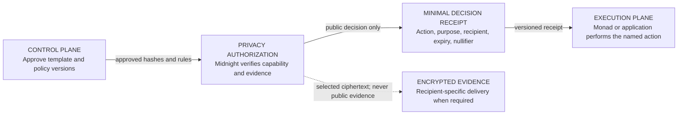
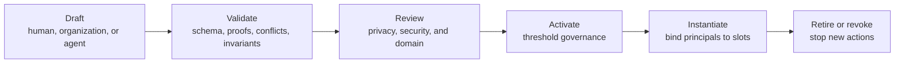
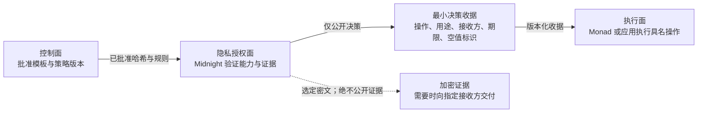
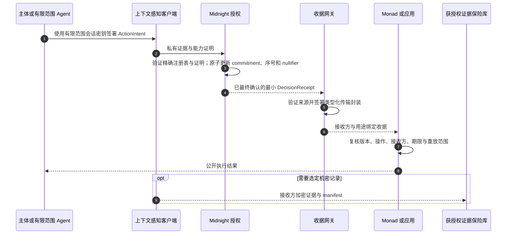

# Permio Programmable Context Architecture

Status: authoritative architecture and implementation contract<br>
Date: 11 October 2026<br>
Scope: versioned scenario templates, context-bound accounts, Midnight privacy authorization, and composable execution

## 1 Decision

Permio is not a fixed review, support, or regulatory application. It is
infrastructure for defining a context, authorizing a narrowly scoped action,
proving only the facts required by that action, and carrying a minimal decision
receipt into an execution system.

The architecture has four independent planes:

1. A **control plane** authors, validates, approves, versions, and retires
   scenario templates and policies.
2. A **privacy authorization plane** evaluates private evidence and
   context-bound capabilities on Midnight.
3. A **high-throughput execution plane** consumes narrow receipts on Monad or
   in an ordinary application without reinterpreting the privacy decision.
4. An **encrypted evidence plane** transports selected confidential records
   directly to an authorized recipient when a proof alone is insufficient.

No architecture component, contract, test, or document may depend on literal
participant names, product names, case identifiers, credential identifiers,
dates, amounts, or other scenario-instance values. Concrete examples and test
fixtures are generated from versioned templates and explicit seeds after a
scenario instance is created.

## 2 Core model

The reusable product unit is a `ScenarioTemplate`. `InformationFlow` is one
runtime action inside a scenario instance.

| Concept | Responsibility | Must not become |
| --- | --- | --- |
| `ScenarioTemplate` | Versioned definition of participant slots, contexts, actions, state transitions, proof requirements, disclosures, and adapters | A bundle of named test participants or instance data |
| `ContextDefinition` | Rules for one social or operational context, including permitted actors, purposes, records, claims, recipients, and transitions | A free-form label with no enforceable semantics |
| `ScenarioInstance` | Runtime binding of one approved template version to actual principals, policy versions, and lifecycle state | A global account role assignment |
| `ContextAccount` | Logical account valid only in one instance or context | A reusable public identity across unrelated contexts |
| `CapabilityGrant` | Authorization for exact actions, resources, purposes, recipients, time, delegation, and disclosure policy | A permanent buyer, merchant, regulator, employee, patient, or agent role |
| `ActionIntent` | Signed request to exercise one capability against current instance state | An implicit permission inferred only from login status |
| `InformationFlow` | Canonical private record of one evaluated action or disclosure | The scenario template or the whole product |
| `DecisionReceipt` | Minimal versioned output stating that one action was approved for one scope | A copy of the source evidence or a universal subject identifier |

The logical relationship is:

```text
ScenarioTemplate + ScenarioInstance + ContextAccount
  + CapabilityGrant + ActionIntent + selected private evidence
  -> InformationFlow evaluation
  -> DecisionReceipt
  -> optional public execution and encrypted evidence delivery
```

## 3 Programmable, context-bound accounts

Registration establishes control of an account key. It does not assign a
business role. Effective authority is derived from active capabilities inside
the selected scenario instance.

```text
CapabilityGrant {
  templateId, templateVersion,
  instanceId, contextId,
  principalRef, sessionPublicKey?,
  actions[], resourceSelector,
  purpose, recipient,
  notBefore, expiresAt,
  disclosurePolicyId,
  delegation: { allowedActions, maxDepth },
  nullifierDomain, revocationRef,
  issuerRef, issuerProof
}
```

Authorization fails closed if any dimension does not match. A correct action
with the wrong context, purpose, recipient, resource, time window, disclosure
policy, delegation depth, or instance is unauthorized.

A session key is a short-lived signing key with a strict subset of a parent
capability. Human users, services, contracts, and automated agents use the same
model. An agent receives permission to perform listed actions, not blanket
access to an account or scenario.

## 4 Architecture views

These diagrams deliberately show one question at a time. Node labels describe
responsibility; edge labels describe the only payload crossing that boundary.

### 4.1 System topology at a glance



The control plane never receives private witness data. The execution plane
never receives enough information to broaden the permission. The encrypted
evidence channel is not routed through either public ledger.

### 4.2 Scenario-template lifecycle



Automated tools may draft, validate, and simulate. They do not create policy
legitimacy. A shared or cross-organization template requires accountable
reviewers and threshold activation of an exact content hash and version.

M4 performs that review and threshold decision with Ed25519 attestations. M6
does not ask every reviewer to register a second Midnight key and does not
claim to re-verify those attestations on-chain. After M4 activation, the
namespace-scoped governance/activation authority signs one exact admission
envelope with the allowlisted `midnight-jubjub-schnorr-v1` profile. Midnight
verifies that authority against the current namespace-authority root and
admits only the exact template version and hash bound by the envelope.

### 4.3 One runtime action

```mermaid
sequenceDiagram
  autonumber
  participant Principal as Principal or scoped agent
  participant Client as Context-aware client
  participant Midnight as Midnight authorization
  participant Gateway as Receipt gateway
  participant Executor as Monad or application
  participant Vault as Authorized evidence vault

  Principal->>Client: Sign ActionIntent with scoped session key
  Client->>Midnight: Private evidence plus capability proof
  Midnight->>Midnight: Verify exact registries and proof; atomically update commitment, sequence, and nullifier
  Midnight-->>Gateway: Finalized minimal DecisionReceipt
  Gateway->>Gateway: Verify source and sign typed transport envelope
  Gateway-->>Executor: Recipient- and purpose-bound receipt
  Executor->>Executor: Recheck version, action, recipient, expiry, and replay scope
  Executor-->>Principal: Public execution result
  opt Selected confidential records are required
    Client-->>Vault: Recipient-encrypted evidence plus manifest
  end
```

## 5 Control plane and scenario library

### 5.1 Template contents

Every template version declares:

- stable template identifier, semantic version, namespace, and content hash;
- participant slots and which principals may fill or assign them;
- context definitions and permitted transitions between contexts;
- action schemas, state preconditions, and resulting state transitions;
- capability issuance, attenuation, delegation, expiry, and revocation rules;
- record, claim, recipient, purpose, and disclosure constraints;
- proof/circuit identifiers and expected public-output schemas;
- optional execution adapters and encrypted-evidence requirements;
- migration and retirement rules; and
- executable privacy invariants, negative cases, and acceptance tests.

### 5.2 Who may design and activate scenarios

| Function | Authorized principal | Constraint |
| --- | --- | --- |
| Draft | Human, organization, or agent with a template-author capability | Draft remains private or namespaced |
| Validate and simulate | Deterministic compiler, verifier, and analysis agents | Reports errors and risk; grants no trust |
| Review | Named privacy, security, and domain reviewers | Attests to one template hash and version |
| Activate | Namespace multisig or threshold governance | Sole author cannot self-activate a high-impact template |
| Instantiate | Principal or allocator with an instantiate capability | Only active versions may be used |
| Assign or delegate | Authority declared by the template and current instance | Cannot grant more authority than it holds |
| Retire or revoke | Declared governance or emergency authority | Stops new actions without rewriting historical receipts |

Template namespaces let an organization use local policies without implying
ecosystem-wide trust. Cross-organization templates require governance roots
recognized by every participating namespace.

### 5.3 Three programmable surfaces and their runtimes

Permio has no global `programmer` or `programmable administrator` role.
Programmability is divided into three separately governed surfaces. A principal
authorized on one surface receives no implied authority on either of the other
two.

| Programmable surface | What may be defined | Proposal capability | Approval boundary | Execution location |
| --- | --- | --- | --- | --- |
| Declarative scenario template | Slots, contexts, actions, transitions, capability rules, disclosure constraints, and references to approved proof profiles and adapters | `template-author` | Exact template hash and version pass review and namespace activation | The template does not execute; authoring tools and `@permio/scenario-domain` validate, canonicalize, and hash it off-chain |
| Proof profile and circuit | Private predicates, witness rules, public outputs, and nullifier domains | `circuit-maintainer` | Privacy/security review plus circuit-governance approval of the exact circuit and output schema | Circuit compilation is offline; proof generation occurs in the client or approved prover; authorization verification occurs on Midnight |
| Execution adapter | The public application or contract effect permitted by a valid receipt | `adapter-developer` | Application deployment and execution-registry governance | Monad smart contract or ordinary application backend |

A template therefore selects approved components by identifier; it cannot
contain JavaScript, TypeScript, Compact, Solidity, a script URL, or another
executable payload. The gateway transports an authorization result and does
not execute template policy. The execution layer may narrow or reject the
approved effect because of current execution state, but it may not broaden it.

### 5.4 Normative system capability matrix

The following names describe scoped capabilities, not permanent business roles
attached at registration. Different capabilities require distinct keys and
authorization checks even when one accountable organization operates more
than one of them. High-assurance acceptance tests use separate identities to
prove that authority does not collapse accidentally.

| Capability holder | May do | Must not do | Required for the core flow |
| --- | --- | --- | --- |
| Template author | Create and revise namespaced drafts | Activate its own high-impact shared template | Yes |
| Template validator | Produce deterministic structural, reference, compatibility, and privacy-risk reports | Grant trust, approve, or activate | Yes; this is a component, not a human authority |
| Privacy reviewer | Attest to disclosure, linkability, recipient, and evidence-boundary properties of one exact hash and version | Edit the reviewed bytes or activate alone | Yes |
| Security reviewer | Attest to replay, signature, circuit, adapter, and upgrade properties of one exact hash and version | Substitute another hash, circuit, or adapter | Yes |
| Domain reviewer | Attest that the declared actions and transitions represent the intended domain rules | Establish the truth of future user claims or records | Yes |
| Namespace activation governance | Activate an exact reviewed template version after its configured threshold is met | Author, allocate, or execute merely because it can activate | Yes; represented by a threshold group rather than one administrator |
| Scenario allocator / instance creator | Instantiate an active version and initiate permitted slot assignment | Activate drafts or fill slots whose assignment rule excludes it | Yes |
| Slot assignment authority | Bind a principal to a slot when allowed by `assignableBy` | Assign unrelated slots or expand delegated authority | As declared by the template; it may be the instance creator, namespace governance, or another occupied slot |
| Emergency revocation authority | Stop specified new uses after compromise or policy withdrawal | Rewrite historical receipts or inherit ordinary authoring powers | Yes |
| Proof/circuit maintainer | Develop and propose versioned proof artifacts | Activate its own artifact or change an active template silently | Required when the proof catalog changes |
| Credential or record issuer | Issue a source credential or signed record accepted by a selected profile | Activate templates, approve unrelated purposes, or read later disclosures automatically | Conditional on the selected template |
| Gateway signer/operator | Verify finalized Midnight output and sign the typed transport envelope | Re-evaluate private evidence or widen the approved action | Yes for cross-plane receipt delivery |
| Execution-registry governor | Configure approved gateway/verifier keys and execution upgrades | Sign ordinary receipts merely because it governs the registry | Yes for governed execution |
| Relayer | Submit a public transaction containing an unchanged valid receipt | Change its recipient, purpose, scope, or expiry | Yes when execution uses a ledger transaction |
| Evidence-vault operator | Deliver recipient-encrypted selected evidence and verify its manifest | Receive plaintext without recipient authorization or infer unrelated context activity | Conditional on confidential evidence delivery |
| Auditor / test observer | Read public events and acceptance evidence | Exercise an operational capability | Recommended; non-authoritative |

`Contract Authority` is not an additional super-role. Governance controllers
decide which exact artifacts and keys are authorized; enforcement contracts
mechanically verify proofs, signatures, thresholds, timelocks, and current
state. A local-development bootstrap key may temporarily hold several
capabilities only when this consolidation is explicit, test-only, and followed
by a tested separation procedure.

### 5.5 Generated end-to-end test cast

Task participants are generated values that occupy template slots; their names
are not protocol roles. Excluding those participants and excluding Agents, the
high-assurance end-to-end suite generates at least these independent control
identities:

1. one template author;
2. one privacy reviewer, one security reviewer, and one domain reviewer;
3. three namespace-governance signers with a two-of-three activation threshold;
4. one scenario allocator / instance creator; and
5. one emergency revocation authority.

It also generates separate service identities for the gateway signer,
execution-registry governor, and relayer. A credential issuer and
evidence-vault operator are added only when the selected template requires
them. The validator, Midnight contract, Monad contract, and privacy scanner are
components, not human roles. An auditor identity has no private operational
key.

The suite must include negative journeys in which each identity attempts at
least one adjacent capability it does not hold: author activation, reviewer
allocation, governance execution, allocator review, relayer mutation, gateway
policy widening, and emergency-authority history rewriting. A smaller user
interface demo may let one person control multiple test keys, but the keys,
capabilities, audit events, and negative assertions remain separate.

### 5.6 Exact control and runtime state represented on Midnight

M6 does not compress all M4 and M5 information into one unexplained root. Each
fact uses the least revealing mechanism that still lets Midnight enforce it.

| Information | Midnight representation | Reason |
| --- | --- | --- |
| Exact active template and lifecycle | Direct public ledger record | Shared, long-lived governance fact that must be independently auditable |
| Eligible namespace authority keys | Versioned namespace-authority Merkle root | The set may be large; proofs need eligibility without publishing real-world identities |
| M4 reviewer approvals | Off-chain Ed25519 evidence committed by the admission envelope | M4 enforces reviewer eligibility and threshold; M6 v1 verifies the authorized admission, not every review signature |
| Instance allocation and capability grants | Private signed assertions | They reveal instance-specific resources, purposes, recipients, and delegation |
| Context-account, capability, and session status | Versioned current-status Merkle root | A proof establishes current active status without publishing the complete permission |
| Private instance state | Public state commitment and transition sequence | Conflicting transitions are ordered without revealing the state label |
| One-use action authorization | Public scoped nullifier | The same private authorization cannot be consumed twice |
| Records, credentials, claims, evidence, and free text | Private witness and off-chain storage | The public protocol does not need the plaintext |

An active-template ledger record contains:

```text
namespaceHash, templateIdHash, semanticVersion, templateContentHash,
governancePolicyHash, authorityRoot, proofModuleBindingsHash,
m4ActivationRecordHash, approvalEvidenceCommitment,
admissionProfileId, admissionKeyHash,
lifecycleStatus, activationSequence, activatedAt,
retiredAt?, revokedAt?, terminationReasonHash?
```

Activation, retirement, and revocation are directly readable events. Retirement
and revocation are prospective: they prevent new uses from their effective
sequence without deleting activation history or earlier receipts. Full template
JSON, validation findings, reviewer comments, and human-readable termination
reasons remain off-chain; their hashes prevent later substitution.

The namespace-authority root has one exact meaning. Each leaf commits to:

```text
namespaceHash, governancePolicyVersion, authorityKind,
authorityKeyHash, validFrom, validUntil
```

`authorityKind` is one of `author`, `reviewer`, `governance-activator`,
`allocator`, `emergency-revoker`, `capability-issuer`,
`protocol-reviewer`, `module-approver`, `module-activator`, or
`module-emergency-revoker`. These sets remain separately scoped; publishing one
root does not merge their powers.

The runtime status root is a keyed current-status Merkle tree, not an
append-only list of revocations. A credential ID commitment selects exactly one
current leaf:

```text
namespaceHash, instanceCommitment, credentialKind,
credentialIdCommitment, status, statusSequence, effectiveAt
```

`credentialKind` is `context-account`, `capability`, or `session`; `status` is
`active` or `revoked`. The Midnight contract stores the current root and its
monotonically increasing root sequence. M6 accepts a credential only by proving
membership of its `active` leaf under the exact current root and sequence. A
revocation replaces that leaf with `revoked` and advances the root sequence.
This design needs ordinary Merkle membership proofs and does not depend on an
unspecified non-membership construction.

The M6 baseline has no separate instance-authority root. The exact allocator
and capability-issuer authorization is carried by private signed assertions,
checked against the namespace-authority root, and committed into the private
instance state. Adding another root later would be a versioned protocol change,
not an implementation convenience.

Neither root may be replaced by a trusted operator writing an arbitrary value.
A namespace-authority update verifies the separately authorized governance
decision over the old root, new root, policy version, and effective sequence.
A runtime-status update proves the old leaf and Merkle path, verifies the exact
issuer or revoker authority, calculates the replacement `active` or `revoked`
leaf, and derives the new root. The ledger then advances the corresponding root
sequence atomically.

### 5.7 Exact M4 activation admission

The M4-to-Midnight boundary is a versioned admission protocol, not a trusted
database copy. Its canonical signed envelope contains:

```text
envelopeVersion
namespaceHash + templateIdHash + semanticVersion + templateContentHash
governancePolicyHash + proofModuleBindingsHash
m4ActivationRecordHash + approvalEvidenceCommitment
authorityRootVersion + authorityRootSequence
targetNetworkId + targetContractIdentity + registryProtocolVersion
admissionNonce
```

The signer must be a currently eligible `governance-activator` for the exact
namespace. The v1 allowlisted admission signature profile is
`midnight-jubjub-schnorr-v1`. The `admit-m4-activation-v1` registry circuit
verifies key eligibility, the exact envelope signature, target binding, and
the unused nonce before it creates the immutable active-version record. Any
field substitution, key substitution, signature-profile substitution, or
nonce replay fails.

This signer cannot manufacture M4 approval evidence. M4 remains responsible
for Ed25519 reviewer signature verification, unique eligible reviewers,
namespace thresholds, rejection state, and separation of duties. Midnight
v1 proves that the authorized M4 governance boundary admitted the exact
activation and commits to its evidence; it does not prove that Midnight
independently checked every reviewer signature. Direct Ed25519 review
verification on Midnight would be a later, separately governed Compact/ledger
protocol upgrade.

The admission key grants no allocator, capability issuer, proof-module
activation, retirement, or emergency-revocation power. Those authorities
remain separately scoped, and neither admission nor termination rewrites an
earlier registry record or receipt.

### 5.8 Extensible, allowlisted proof modules

Templates are data and cannot introduce executable proof logic. Each action
references one exact active proof implementation:

```text
proofModuleId, proofModuleVersion, implementationHash,
configurationHash, receiptSchemaHash
```

The reference never uses `latest`. Configuration is bounded by the module's
approved configuration schema. Unknown fields, unsupported values, executable
expressions, and unregistered implementation hashes fail closed with
`UNSUPPORTED_PROOF_REQUIREMENT` or a more specific validation result.

The initial reusable runtime proof families are:

- `delegated-capability-action-v1`, which checks issuer eligibility,
  attenuation, session scope, exact intent, time, current credential status,
  and replay; and
- `private-state-transition-v1`, which checks the committed previous state,
  permitted deterministic transition, calculated next-state commitment, and
  single consumption of the old state.

The physical M6 deployment is also fixed. One versioned Compact authorization
contract contains the registries, root/state ledgers, common receipt logic,
the `admit-m4-activation-v1` registry entry point, and the two initial runtime
module entry points. A module's
`implementationReference` is the exact contract address, contract version, and
circuit entry-point name together with the implementation hash. Compact does
not dynamically load template code. A future proof family is introduced by a
new versioned contract deployment and registry record through the protocol
upgrade process; existing template bindings remain pinned to their original
deployment.

A proof module is governed as a protocol implementation, independently of
ordinary template governance. Its public registry record contains:

```text
moduleId, moduleVersion, implementationReference,
sourceHash, implementationHash, inputSchemaHash,
configurationSchemaHash, receiptSchemaHash, compilerVersion,
compatibilityPolicyHash, status, activationSequence,
activatedAt?, deprecatedAt?, revokedAt?, approvalEvidenceCommitment
```

Its lifecycle is fixed:

```text
proposed -> reviewed -> approved -> active -> deprecated
                                      |
                                      +-> revoked
```

Review reports evidence but grants no trust. Approval requires independent
human security/privacy review and a high-threshold protocol-governance decision
over the exact source, compiled implementation, schemas, compiler version,
compatibility policy, and deployment reference. A separate module-activation
authority makes it usable. A separate emergency authority may prospectively
revoke it. Agents may implement and test modules but do not count toward the
human approval threshold and cannot activate them.

Deprecation prevents new template activations from selecting the module.
Existing instances follow the compatibility policy approved with that exact
module version. Revocation rejects new proofs prospectively. Neither event
rewrites historical receipts. A new module version never migrates a template
silently: the template must create a new revision, pass M4 review again, and
pin the new implementation hash.

## 6 Privacy authorization and execution boundary

M6 is stateful for actions whose template declares an authorization-state
transition. Midnight decides whether an action is permitted and which private
authorization-state transition becomes authoritative. Monad or an application
separately decides whether the downstream public effect executes. An approved
Midnight transition never falsely asserts that downstream execution succeeded.

For a state-transitioning action, one Midnight transaction atomically:

1. verifies the private allocation, capability, session, action intent, and
   selected evidence;
2. verifies the exact active template, authority-root sequence, runtime-status
   root sequence, proof-module version, implementation hash, and configuration;
3. checks that the supplied previous state commitment and transition sequence
   equal current ledger state;
4. proves that the template permits exactly one next authorization state;
5. consumes the scoped nullifier;
6. installs the calculated next-state commitment; and
7. increments the transition sequence and emits one `DecisionReceipt`.

Only one transaction can consume a given previous commitment and sequence.
Competing proof computation may be wasted, but correctness does not depend on a
proof-generation lock. Proof time and contention are measured during on-chain
testing; coordination is added only through a later explicit performance
decision.

For an action with no template-declared state transition, M6 verifies the same
private authorization and current registries, consumes a scoped nullifier when
the action is single-use, and emits a receipt without changing the instance
state commitment.

All proof modules emit one common envelope:

```text
DecisionReceipt {
  receiptVersion,
  proofModuleId, proofModuleVersion, implementationHash,
  namespaceHash, templateIdHash, templateVersion, templateContentHash,
  instanceCommitment, previousStateCommitment?, nextStateCommitment?,
  transitionSequence?, contextHash, actionSchemaId,
  purposeHash, recipient,
  validAfter, validBefore,
  scopedNullifier,
  outputCommitment,
  sourceNetwork, sourceContract, sourceTransaction, sourceLedgerSequence
}
```

Textual namespace, template, context, and purpose values are represented by
versioned hashes. The recipient remains the exact downstream recipient needed
for enforcement. The receipt excludes private evidence, state labels, reviewer
identities, capability scope, account and session keys, credentials, free text,
and unrelated instance activity. Its nullifier domain includes the receipt
version, proof module and implementation, exact template, instance, context,
action, resource commitment, purpose, recipient, and policy versions.

A module may include additional module-specific material only inside
`outputCommitment`. The gateway and execution layer consume the common envelope
and the explicitly registered receipt schema; they do not reinterpret private
policy or silently broaden module-specific output.

The execution layer may reject an approved receipt because of local execution
state, but it may not convert it into a broader action. A schema or policy
change requires a new version and explicit compatibility rules.

## 7 Component responsibilities

| Component | Receives | Processes | Emits |
| --- | --- | --- | --- |
| Scenario authoring tools | Draft template and referenced schemas | Editing, simulation, linting | Draft content hash |
| Template validator | Draft, circuit metadata, invariants | Deterministic structural and privacy checks | Validation report |
| Governance registry | Reviewer attestations and activation proposal | Threshold and namespace checks over exact hashes | M4 activation evidence for Midnight submission |
| Midnight template registry | M4 activation, retirement, or revocation evidence | Exact target, authority root, lifecycle sequence, and proof-module binding checks | Direct public template lifecycle record |
| Midnight proof-module registry | Reviewed implementation and protocol-governance evidence | Exact hashes, lifecycle, compatibility, and separated activation checks | Active/deprecated/revoked module record |
| Scenario allocator | Active template and instantiate capability | Binds principals to slots | Scenario instance commitment |
| Context-aware client | Instance state, capabilities, private records | Disclosure preview and ActionIntent signing | Private proof request |
| Midnight authorization contract | Private proof request plus current registry references | Capability, evidence, status, atomic state, and uniqueness verification | Minimal `DecisionReceipt` fields and updated commitments |
| Gateway | Finalized public Midnight output | Finality, source, allowlist, schema, and byte-exact envelope checks | Typed transport signature over the unchanged receipt |
| Monad registry or application | Typed receipt | Signer, schema, recipient, expiry, and replay checks | Public action result |
| Evidence vault | Ciphertext and manifest | Recipient decryption and integrity checks | Selected recipient view |

## 8 Required first scenario profiles

These three profiles are part of Permio's architecture and must run through the
same template, capability, privacy-authorization, receipt, and execution model.
They are not embedded fixtures: concrete participants, records, identifiers,
values, dates, and policies are generated or supplied only when a template is
instantiated.

### 8.1 Clinical referral and research consent

A patient can authorize one specialist to access selected observations for a
treatment purpose and limited period. A later research request is a different
context: a research service may receive only an eligibility or cohort claim,
not the treatment record or the specialist relationship. Emergency access, if
supported, is a separately governed action with a short lifetime and an audit
obligation.

This family exercises recipient changes, purpose changes, consent expiry,
revocation, sensitive encrypted evidence, and a deliberate transition from
treatment to research. HL7 FHIR Consent already models recipients, actions,
purposes, data, and effective periods and allows computable consent rules; it is
useful input for a future Permio healthcare profile, not a dependency silently
assumed by the core protocol.

### 8.2 Professional qualification and temporary site access

A credential holder proves that a required qualification is current for one
site, task, and shift without revealing a full transcript, unrelated
certifications, home address, or employment history. A site system issues a
short-lived access capability. If an incident occurs, the holder may authorize
a separate evidence bridge to a named investigator without making the original
presentation globally linkable.

This family exercises issuer authority, credential status and revocation,
selective claims, time-bounded access, and a later investigator context. W3C
Verifiable Credentials materials describe education and professional
qualification use cases, holder-controlled disclosure, duration limits, and
correlation risks; Permio adds context transitions and execution receipts
around those credentials.

### 8.3 Delegated financial or purchasing agent

A person authorizes an automated agent to perform one named transaction or
class of transactions for a named counterparty, bounded resource, purpose,
amount policy, and expiry. The agent cannot inspect unrelated account history,
change the recipient, delegate indefinitely, activate templates, or reuse an
approval after revocation. The privacy plane approves the exact intent; the
execution plane performs the high-volume transaction.

This family exercises machine principals, capability attenuation, monetary or
resource ceilings, explicit counterparties, rapid revocation, and separation of
authorization from execution. OAuth Rich Authorization Requests demonstrates
the need for structured fine-grained authorization details beyond broad scope
strings. ODRL provides another useful policy vocabulary for parties, actions,
assets, constraints, and duties. Permio must profile such ideas rather than
accept arbitrary policy text at runtime.

## 9 Contract authority and governance

“Contract Authority” must not name one permanent manager or one autonomous
program. It combines two responsibilities that must remain distinct:

- a **governance controller** decides which exact issuer, template version,
  policy hash, circuit, verifier, upgrade, or emergency action is authorized;
  and
- an **enforcement contract** automatically verifies the corresponding proof,
  signature, threshold, timelock, and current state.

A single bootstrap secret may exist only in local development and must be
labelled transitional. Production authority is divided into separately scoped
capabilities for template activation, issuer admission, circuit upgrades,
gateway rotation, execution-registry administration, and emergency revocation.
Daily issuers, relayers, agents, and scenario allocators do not hold governance
keys.

## 10 Security and privacy invariants

1. No global public pseudonym links a principal across scenario instances or
   contexts.
2. Every authorization binds template version, instance, context, action,
   resource, purpose, recipient, time, and disclosure policy.
3. Delegation attenuates authority; it never expands it.
4. Review, validation, activation, allocation, and execution are distinct
   capabilities.
5. Agents cannot self-approve templates or obtain blanket account access.
6. Private source records and witness data never enter the gateway, Monad, or a
   public application store.
7. Cross-context disclosure is explicit, purpose-bound, recipient-bound,
   selected-record-bound, expiring, and revocable where the protocol permits.
8. A proof establishes only the claims encoded by its circuit and policy. It
   does not establish that an opinion, allegation, diagnosis, or human judgment
   is true.
9. Template and receipt schema changes are versioned protocol changes.
10. Architecture documents and tests reference generated fixture schemas and
    seeds, never literal scenario-instance data.
11. Templates reference only exact active proof-module versions and hashes;
    unsupported proof semantics stop activation rather than being approximated.
12. Public template and module registries, authority roots, credential-status
    roots, state commitments, and nullifiers have separate meanings and domains.
13. Midnight owns authorization-state ordering, while Monad or the target
    application owns downstream execution success or failure.

## 11 Generated examples and deterministic testing

Concrete scenarios are generated after template selection:

```text
template + generatorVersion + explicitSeed + policyProfile
  -> scenario instance
  -> principals, records, credentials, cases, values, and timestamps
  -> expected private/public classification
  -> positive and negative test vectors
```

The generator must be deterministic for tests, but its output is not protocol
law. Golden vectors record generator version, seed, template hash, and expected
commitments. Changing a generated participant name or instance identifier must
not require architecture, circuit, or application source changes.

Production data is never generated from test seeds. Test output must use
synthetic values and must pass a public-artifact scan proving that fields
classified private are absent from ledgers, receipts, logs, and generated HTML.

## 12 Research basis

- [HL7 FHIR Consent](https://hl7.org/fhir/consent.html) — computable healthcare
  consent with recipients, actions, purposes, data, and periods.
- [W3C Verifiable Credentials Use Cases](https://www.w3.org/TR/vc-use-cases/) —
  education, professional, health, and holder-controlled disclosure examples.
- [W3C Verifiable Credentials Data Model 2.0](https://www.w3.org/TR/vc-data-model-2.0/) —
  credential privacy, selective disclosure, and correlation considerations.
- [RFC 9396: OAuth 2.0 Rich Authorization Requests](https://www.rfc-editor.org/rfc/rfc9396.html) —
  structured fine-grained authorization details.
- [W3C ODRL Information Model 2.2](https://www.w3.org/TR/odrl-model/) — parties,
  actions, assets, constraints, duties, and policy profiles.

These sources inform the required profiles. Permio's profile semantics are
defined by this architecture; adopting an external serialization or runtime
dependency still requires an explicit compatibility decision and tests.

---

# Permio 可编程情境架构

状态：权威架构与实施契约<br>
日期：2026 年 10 月 11 日<br>
范围：版本化情境模板、上下文账户、Midnight 隐私授权与可组合执行

## 1 架构决策

Permio 不是一个固定的评价、客服或监管应用。它是一套用于定义情境、授权有限范围操作、
只证明该操作所需事实，并把最小决策收据交给执行系统的基础设施。

架构包含四个相互独立的平面：

1. **控制面**负责编写、验证、批准、版本化和退役情境模板及策略。
2. **隐私授权面**在 Midnight 上评估私有证据与受上下文约束的能力。
3. **高吞吐执行面**在 Monad 或普通应用中消费狭窄收据，而不重新解释隐私决定。
4. 当证明本身不足时，**加密证据面**把选定机密记录直接交给获授权接收方。

任何架构组件、合约、测试或文档都不得依赖写死的参与者姓名、产品名称、案件标识符、
凭证标识符、日期、金额或其他情境实例值。具体示例和测试数据必须在创建情境实例之后，
根据版本化模板和显式种子生成。

## 2 核心模型

可复用的产品单元是 `ScenarioTemplate`。`InformationFlow` 是情境实例内的一次运行时操作。

| 概念 | 职责 | 不得变成 |
| --- | --- | --- |
| `ScenarioTemplate` | 对参与者槽位、上下文、操作、状态转换、证明要求、披露和适配器进行版本化定义 | 具名测试参与者和实例数据的集合 |
| `ContextDefinition` | 定义一个社会或操作上下文中的参与者、用途、记录、声明、接收方与转换规则 | 没有可执行语义的自由文本标签 |
| `ScenarioInstance` | 把一个已批准模板版本与实际主体、策略版本和生命周期状态绑定 | 全局账户角色分配 |
| `ContextAccount` | 只在一个实例或上下文中有效的逻辑账户 | 在无关上下文之间复用的公开身份 |
| `CapabilityGrant` | 对精确操作、资源、用途、接收方、时间、委托和披露策略进行授权 | 永久买家、商家、监管者、员工、患者或 Agent 角色 |
| `ActionIntent` | 针对当前实例状态行使一个能力的签名请求 | 仅由登录状态隐式推导的权限 |
| `InformationFlow` | 一次经过评估的操作或披露的规范化私有记录 | 情境模板或整个产品 |
| `DecisionReceipt` | 说明一个操作在一个范围内获批准的最小版本化输出 | 来源证据副本或通用主体标识符 |

逻辑关系如下：

```text
ScenarioTemplate + ScenarioInstance + ContextAccount
  + CapabilityGrant + ActionIntent + 所选私有证据
  -> InformationFlow 评估
  -> DecisionReceipt
  -> 可选公开执行与加密证据交付
```

## 3 可编程、受上下文约束的账户

注册只建立账户密钥控制权，不分配业务角色。有效权限由所选情境实例中的活跃能力推导。

```text
CapabilityGrant {
  templateId, templateVersion,
  instanceId, contextId,
  principalRef, sessionPublicKey?,
  actions[], resourceSelector,
  purpose, recipient,
  notBefore, expiresAt,
  disclosurePolicyId,
  delegation: { allowedActions, maxDepth },
  nullifierDomain, revocationRef,
  issuerRef, issuerProof
}
```

任何维度不匹配都必须默认拒绝。即使操作正确，只要上下文、用途、接收方、资源、时间窗口、
披露策略、委托深度或实例不匹配，也不构成授权。

会话密钥是只拥有父能力严格子集的短期签名密钥。人类用户、服务、合约与自动化 Agent
使用同一模型。Agent 只能获得执行列出操作的权限，不能获得账户或情境的全面访问。

## 4 架构视图

下面每张图只回答一个问题。节点描述职责，边描述唯一允许跨越该边界的载荷。

### 4.1 一眼看懂系统拓扑



控制面不接收私有见证数据。执行面不会获得足以扩大权限的信息。加密证据通道不经过任一
公开账本。

### 4.2 情境模板生命周期


自动化工具可以草拟、验证和模拟，但不能赋予策略合法性。共享或跨组织模板需要可问责的
审核者，并通过阈值机制激活精确的内容哈希和版本。

M4 使用 Ed25519 证明完成审核与阈值决定。M6 不要求每个审核者再登记一套 Midnight 密钥，
也不声称在链上重新验证这些证明。M4 激活后，命名空间范围内的治理／激活权限使用 allowlist
中的 `midnight-jubjub-schnorr-v1` profile 对一份精确登记封装签名。Midnight 对照当前
namespace 权限 root 验证该权限，并且只登记封装绑定的精确模板版本与哈希。

### 4.3 一次运行时操作



## 5 控制面与情境库

### 5.1 模板内容

每个模板版本声明：

- 稳定模板标识符、语义版本、命名空间和内容哈希；
- 参与者槽位以及哪些主体可以填充或分配这些槽位；
- 上下文定义及上下文之间允许的转换；
- 操作模式、状态前置条件及产生的状态转换；
- 能力签发、收缩、委托、到期和撤销规则；
- 记录、声明、接收方、用途和披露约束；
- 证明/电路标识符和预期公开输出模式；
- 可选执行适配器及加密证据要求；
- 迁移和退役规则；以及
- 可执行隐私不变量、负向案例和验收测试。

### 5.2 谁可以设计和激活情境

| 功能 | 获授权主体 | 约束 |
| --- | --- | --- |
| 草拟 | 持有模板作者能力的人、组织或 Agent | 草稿保持私有或只存在于命名空间内 |
| 验证与模拟 | 确定性编译器、验证器和分析 Agent | 报告错误和风险，但不授予信任 |
| 审核 | 具名隐私、安全和领域审核者 | 只为一个模板哈希和版本背书 |
| 激活 | 命名空间多签或阈值治理 | 唯一作者不能自行激活高影响模板 |
| 实例化 | 持有实例化能力的主体或分配器 | 只能使用活跃版本 |
| 分配或委托 | 模板及当前实例声明的权限方 | 不能授予超过自身范围的权限 |
| 退役或撤销 | 声明的治理方或紧急权限方 | 停止新操作，但不改写历史收据 |

模板命名空间允许组织使用本地策略，而不暗示整个生态都信任它。跨组织模板需要每个参与
命名空间都认可的治理根。

### 5.3 三类可编程表面及其运行位置

Permio 不存在全局 `programmer` 或“可编程管理员”角色。可编程性被拆分为三个独立治理的
表面；主体在其中一个表面获得授权，不会隐含获得另外两个表面的权限。

| 可编程表面 | 可以定义什么 | 提案能力 | 批准边界 | 执行位置 |
| --- | --- | --- | --- | --- |
| 声明式情境模板 | 槽位、上下文、操作、转换、能力规则、披露约束，以及对获批证明配置和适配器的引用 | `template-author` | 精确模板哈希和版本通过审核与命名空间激活 | 模板本身不执行；编写工具和 `@permio/scenario-domain` 在链下验证、规范化并计算哈希 |
| 证明配置与电路 | 私有谓词、见证规则、公开输出和空值标识域 | `circuit-maintainer` | 隐私/安全审核，加上电路治理对精确电路及输出模式的批准 | 电路离线编译；客户端或获批证明服务生成证明；Midnight 验证授权 |
| 执行适配器 | 有效收据允许产生的公开应用或合约效果 | `adapter-developer` | 应用部署与执行注册表治理 | Monad 智能合约或普通应用后端 |

因此，模板只能通过标识符选择已获批准的组件；它不能包含 JavaScript、TypeScript、Compact、
Solidity、脚本 URL 或其他可执行载荷。网关只传输授权结果，不执行模板策略。执行层可以因为
当前执行状态而缩小或拒绝已批准效果，但不能扩大它。

### 5.4 规范性系统能力矩阵

下列名称表示有限范围的能力，而不是注册时附加的永久业务角色。即使由同一个可问责组织运营
多个能力，每项能力仍需使用独立密钥和授权检查。高保证验收测试使用不同身份，以证明权限不会
意外坍缩。

| 能力持有者 | 可以做什么 | 不得做什么 | 核心流程是否需要 |
| --- | --- | --- | --- |
| 模板作者 | 创建和修订命名空间内的草稿 | 自行激活其高影响共享模板 | 是 |
| 模板验证器 | 生成确定性的结构、引用、兼容性和隐私风险报告 | 授予信任、批准或激活 | 是；它是组件，不是人类权限方 |
| 隐私审核者 | 对一个精确哈希和版本的披露、关联、接收方及证据边界作出背书 | 修改已审核字节或单独激活 | 是 |
| 安全审核者 | 对一个精确哈希和版本的重放、签名、电路、适配器及升级属性作出背书 | 替换其他哈希、电路或适配器 | 是 |
| 领域审核者 | 确认声明的操作和转换表达了预期领域规则 | 证明未来用户声明或记录的真实性 | 是 |
| 命名空间激活治理方 | 在达到配置阈值后激活精确的已审核模板版本 | 仅因拥有激活能力而获得编写、分配或执行权限 | 是；使用阈值组，而不是单个管理员 |
| 情境分配者/实例创建者 | 实例化活跃版本并启动获准的槽位分配 | 激活草稿或填充规则不允许其分配的槽位 | 是 |
| 槽位分配权限方 | 在 `assignableBy` 允许时把主体绑定到槽位 | 分配无关槽位或扩大委托权限 | 由模板声明；可以是实例创建者、命名空间治理方或另一个已占用槽位 |
| 紧急撤销方 | 在受损或政策撤回后阻止指定的新使用 | 改写历史收据或继承普通编写权限 | 是 |
| 证明/电路维护者 | 开发并提出版本化证明产物 | 自行激活产物或静默修改活跃模板 | 证明目录变更时需要 |
| 凭证或记录签发者 | 签发所选配置接受的源凭证或签名记录 | 激活模板、批准无关用途或自动读取后续披露 | 取决于所选模板 |
| 网关签名者/运营者 | 验证已最终确认的 Midnight 输出并签署类型化传输封装 | 重新评估私有证据或扩大获准操作 | 跨平面交付收据时需要 |
| 执行注册表治理方 | 配置获准网关/验证者密钥及执行升级 | 仅因治理注册表而签署日常收据 | 受治理执行时需要 |
| 中继者 | 提交包含未修改有效收据的公开交易 | 修改接收方、用途、范围或期限 | 执行使用账本交易时需要 |
| 证据保险库运营者 | 交付面向接收方加密的选定证据并验证 manifest | 未经接收方授权获得明文或推断无关上下文活动 | 取决于是否交付机密证据 |
| 审计者/测试观察者 | 读取公开事件和验收证据 | 行使操作能力 | 建议设置；无授权能力 |

`Contract Authority` 不是另一个超级角色。治理控制者决定授权哪些精确产物和密钥；执行合约
机械地验证证明、签名、阈值、时间锁和当前状态。只有在权限合并被明确标记为仅供测试，并且有
经过测试的拆分流程时，本地开发引导密钥才能暂时持有多个能力。

### 5.5 生成式端到端测试角色阵容

任务参与者是填充模板槽位的生成值；其姓名不是协议角色。在排除这些参与者和 Agent 后，高保证
端到端测试至少生成以下相互独立的控制身份：

1. 一名模板作者；
2. 一名隐私审核者、一名安全审核者和一名领域审核者；
3. 三名命名空间治理签名者，激活阈值为三选二；
4. 一名情境分配者/实例创建者；以及
5. 一名紧急撤销方。

测试还为网关签名者、执行注册表治理方和中继者生成独立服务身份。只有所选模板需要时，才加入
凭证签发者和证据保险库运营者。验证器、Midnight 合约、Monad 合约和隐私扫描器是组件，不是
人类角色。审计身份不持有私有操作密钥。

测试必须包含负向旅程，让每个身份至少尝试一项自己不具备的相邻能力：作者尝试激活、审核者
尝试分配、治理方尝试执行、分配者尝试审核、中继者尝试篡改、网关尝试扩大策略，以及紧急权限
方尝试改写历史。较小的用户界面演示可以让一个人控制多个测试密钥，但密钥、能力、审计事件和
负向断言仍保持分离。

### 5.6 Midnight 上的精确控制状态与运行时状态

M6 不会把所有 M4 和 M5 信息塞进一个含义不明的状态根。每类事实都使用既能让 Midnight
执行检查、又尽量少披露信息的机制。

| 信息 | Midnight 表示方式 | 原因 |
| --- | --- | --- |
| 精确活跃模板及其生命周期 | 直接公开账本记录 | 共享、长期存在且必须可独立审计的治理事实 |
| 合格 namespace 权限密钥 | 版本化 namespace 权限 Merkle root | 集合可能很大；证明需要验证资格但不应公开现实身份 |
| M4 审核者批准 | 由登记封装 commitment 的链下 Ed25519 证据 | M4 执行审核者资格与阈值；M6 v1 验证获授权登记，而不是每个审核签名 |
| 实例分配与 capability grant | 私有签名断言 | 会暴露实例特定资源、用途、接收方和委托范围 |
| 上下文账户、capability 与 session 状态 | 版本化当前状态 Merkle root | 在不公开完整权限的情况下证明当前 active 状态 |
| 私有实例状态 | 公开状态 commitment 与转换序号 | 在不披露状态标签的情况下为冲突转换排序 |
| 一次性操作授权 | 公开限定范围 nullifier | 同一私有授权不能被消费两次 |
| 记录、凭证、声明、证据与自由文本 | 私有见证与链下存储 | 公开协议不需要明文 |

活跃模板账本记录包含：

```text
namespaceHash, templateIdHash, semanticVersion, templateContentHash,
governancePolicyHash, authorityRoot, proofModuleBindingsHash,
m4ActivationRecordHash, approvalEvidenceCommitment,
admissionProfileId, admissionKeyHash,
lifecycleStatus, activationSequence, activatedAt,
retiredAt?, revokedAt?, terminationReasonHash?
```

激活、退役和撤销都是可直接读取的事件。退役与撤销前瞻性生效：从其生效序号开始阻止新的
使用，但不删除激活历史或早期收据。完整模板 JSON、验证发现、审核意见和人类可读终止原因
留在链下；其哈希防止以后替换内容。

Namespace 权限 root 只有一个精确含义。每个叶子 commitment 包含：

```text
namespaceHash, governancePolicyVersion, authorityKind,
authorityKeyHash, validFrom, validUntil
```

`authorityKind` 是 `author`、`reviewer`、`governance-activator`、`allocator`、
`emergency-revoker`、`capability-issuer`、`protocol-reviewer`、`module-approver`、
`module-activator` 或 `module-emergency-revoker`。这些权限集合仍然各自独立；发布在同一个
root 中不会合并它们的权力。

运行时状态 root 是按 credential ID commitment 寻址的“当前状态 Merkle tree”，不是仅追加
的撤销列表。每个 credential ID commitment 精确对应一个当前叶子：

```text
namespaceHash, instanceCommitment, credentialKind,
credentialIdCommitment, status, statusSequence, effectiveAt
```

`credentialKind` 是 `context-account`、`capability` 或 `session`；`status` 是 `active` 或
`revoked`。Midnight 合约存储当前 root 及单调递增的 root 序号。M6 只在证明某个 credential
的 `active` 叶子属于精确当前 root 和序号时才接受它。撤销会把该叶子替换为 `revoked` 并推进
root 序号。该设计只需要普通 Merkle 成员证明，不依赖尚未定义的非成员证明。

M6 基线不引入独立的实例权限 root。精确分配器与 capability 签发者权限通过私有签名断言
携带、对照 namespace 权限 root 检查，并写入私有实例状态 commitment。以后增加另一种 root
必须作为版本化协议变更处理，不能只是实现便利。

任何 root 都不能由受信任操作员随意写入新值。Namespace 权限更新必须验证对 old root、new root、
策略版本和生效序号作出的独立治理授权。运行时状态更新必须证明旧叶子及 Merkle path、验证精确
签发者或撤销者权限、计算替代的 `active` 或 `revoked` 叶子并导出新 root；随后账本原子推进相应
root 序号。

### 5.7 精确 M4 激活登记

M4 到 Midnight 的边界是版本化登记协议，而不是受信任的数据库复制。其规范签名封装包含：

```text
envelopeVersion
namespaceHash + templateIdHash + semanticVersion + templateContentHash
governancePolicyHash + proofModuleBindingsHash
m4ActivationRecordHash + approvalEvidenceCommitment
authorityRootVersion + authorityRootSequence
targetNetworkId + targetContractIdentity + registryProtocolVersion
admissionNonce
```

签名者必须是精确 namespace 当前合格的 `governance-activator`。v1 allowlist 登记签名 profile
为 `midnight-jubjub-schnorr-v1`。`admit-m4-activation-v1` 注册电路在创建不可变 active-version
记录前，验证密钥资格、精确封装签名、目标绑定和未使用 nonce。替换任何字段、密钥、签名
profile，或重放 nonce 都会失败。

该签名者不能伪造 M4 批准证据。M4 继续负责 Ed25519 审核签名验证、合格审核者唯一性、
namespace 阈值、拒绝状态和职责分离。Midnight v1 证明获授权的 M4 治理边界登记了精确激活，
并 commitment 其证据；它不证明 Midnight 独立检查了每个审核者签名。若以后需要在 Midnight
直接验证 Ed25519 审核证明，必须作为独立治理的 Compact／ledger 协议升级处理。

登记密钥不授予 allocator、capability 签发、证明模块激活、退役或紧急撤销权限。这些权限仍然
分别限定；登记和终止都不能改写较早的注册记录或收据。

### 5.8 可扩展但受 allowlist 控制的证明模块

模板是数据，不能引入可执行证明逻辑。每个操作引用一个精确的活跃证明实现：

```text
proofModuleId, proofModuleVersion, implementationHash,
configurationHash, receiptSchemaHash
```

引用绝不能使用 `latest`。配置受模块已批准的配置 schema 限制。未知字段、不支持的值、可执行
表达式和未登记实现哈希必须默认拒绝，并返回 `UNSUPPORTED_PROOF_REQUIREMENT` 或更具体的
验证结果。

首批可复用运行时证明类型为：

- `delegated-capability-action-v1`：检查签发者资格、权限收缩、会话范围、精确意图、时间、
  当前 credential 状态和重放；以及
- `private-state-transition-v1`：检查已 commitment 的前一状态、允许的确定性转换、正确计算的
  下一状态 commitment，以及旧状态只能被消费一次。

M6 的物理部署同样固定。一个版本化 Compact 授权合约包含注册表、root／状态账本、通用收据
逻辑、`admit-m4-activation-v1` 注册入口和两个首批运行时模块入口。模块的
`implementationReference` 由精确合约地址、合约版本、
电路入口名称和实现哈希共同构成。Compact 不会动态加载模板代码。未来证明类型通过协议升级流程
创建新的版本化合约部署和注册记录；现有模板绑定继续固定到原始部署。

证明模块作为协议实现治理，独立于普通模板治理。其公开注册记录包含：

```text
moduleId, moduleVersion, implementationReference,
sourceHash, implementationHash, inputSchemaHash,
configurationSchemaHash, receiptSchemaHash, compilerVersion,
compatibilityPolicyHash, status, activationSequence,
activatedAt?, deprecatedAt?, revokedAt?, approvalEvidenceCommitment
```

其生命周期固定为：

```text
proposed -> reviewed -> approved -> active -> deprecated
                                      |
                                      +-> revoked
```

审核只报告证据，不授予信任。批准要求独立人工安全／隐私审核，以及高阈值协议治理对精确源码、
编译实现、schema、编译器版本、兼容策略和部署引用作出决定。独立模块激活权限使模块可用；独立
紧急权限可以前瞻性撤销。Agent 可以实现和测试模块，但不能计入人工批准阈值，也不能激活模块。

弃用阻止新的模板激活选择该模块。现有实例按照与该精确模块版本共同批准的兼容策略处理。撤销
前瞻性拒绝新证明。两者都不改写历史收据。新模块版本绝不能静默迁移模板：模板必须创建新修订、
重新通过 M4 审核并固定新的实现哈希。

## 6 隐私授权与执行边界

对于模板声明会改变授权状态的操作，M6 是有状态的。Midnight 决定操作是否允许，以及哪个私有
授权状态转换成为权威结果。Monad 或普通应用另行决定下游公开效果是否成功执行。Midnight 上
已批准的转换绝不能错误声称下游执行已经成功。

对于状态转换操作，一笔 Midnight 交易原子完成：

1. 验证私有分配、capability、session、ActionIntent 和选定证据；
2. 验证精确活跃模板、权限 root 序号、运行时状态 root 序号、证明模块版本、实现哈希和配置；
3. 检查提供的前一状态 commitment 与转换序号等于当前账本状态；
4. 证明模板只允许一个下一授权状态；
5. 消费限定范围 nullifier；
6. 安装计算出的下一状态 commitment；以及
7. 增加转换序号并发出一份 `DecisionReceipt`。

只有一笔交易能够消费某个前一 commitment 与序号。竞争证明可能浪费计算，但正确性不依赖证明
生成锁。真实链测试会测量证明时间和冲突；只有后续明确的性能决策才能增加协调机制。

对于模板未声明状态转换的操作，M6 验证同样的私有授权和当前注册表；如果操作只能使用一次，
则消费限定范围 nullifier；随后发出收据，但不修改实例状态 commitment。

所有证明模块输出同一种通用封装：

```text
DecisionReceipt {
  receiptVersion,
  proofModuleId, proofModuleVersion, implementationHash,
  namespaceHash, templateIdHash, templateVersion, templateContentHash,
  instanceCommitment, previousStateCommitment?, nextStateCommitment?,
  transitionSequence?, contextHash, actionSchemaId,
  purposeHash, recipient,
  validAfter, validBefore,
  scopedNullifier,
  outputCommitment,
  sourceNetwork, sourceContract, sourceTransaction, sourceLedgerSequence
}
```

文本 namespace、template、context 和 purpose 使用版本化哈希表示。接收方保留为下游执行所需
的精确地址。收据不包含私有证据、状态标签、审核者身份、capability 范围、账户或会话密钥、
凭证、自由文本或无关实例活动。Nullifier 域包含收据版本、证明模块与实现、精确模板、实例、
上下文、操作、资源 commitment、用途、接收方和策略版本。

模块特定的额外材料只能进入 `outputCommitment`。网关和执行层只消费通用封装和明确登记的收据
schema；它们不重新解释私有策略，也不静默扩大模块特定输出。

执行层可以因为本地执行状态而拒绝一份已批准收据，但不能把它转换为更宽的操作。模式或
策略变更需要新版本和显式兼容规则。

## 7 组件职责

| 组件 | 接收 | 处理 | 输出 |
| --- | --- | --- | --- |
| 情境编写工具 | 模板草稿与引用模式 | 编辑、模拟、lint | 草稿内容哈希 |
| 模板验证器 | 草稿、电路元数据、不变量 | 确定性结构与隐私检查 | 验证报告 |
| 治理注册表 | 审核者背书与激活提案 | 对精确哈希执行阈值与 namespace 检查 | 提交给 Midnight 的 M4 激活证据 |
| Midnight 模板注册表 | M4 激活、退役或撤销证据 | 精确目标、权限 root、生命周期序号与证明模块绑定检查 | 直接公开的模板生命周期记录 |
| Midnight 证明模块注册表 | 已审核实现与协议治理证据 | 精确哈希、生命周期、兼容性和独立激活检查 | active／deprecated／revoked 模块记录 |
| 情境分配器 | 活跃模板与实例化能力 | 把主体绑定到槽位 | 情境实例承诺 |
| 上下文感知客户端 | 实例状态、能力、私有记录 | 披露预览与 ActionIntent 签名 | 私有证明请求 |
| Midnight 授权合约 | 私有证明请求与当前注册表引用 | 验证 capability、证据、状态、原子转换与唯一性 | 最小 `DecisionReceipt` 字段和更新后的 commitment |
| 网关 | 已最终确认的 Midnight 公开输出 | 最终性、来源、allowlist、schema 和逐字节封装检查 | 对未修改收据的类型化传输签名 |
| Monad 注册表或应用 | 类型化收据 | 验证签名者、模式、接收方、期限与重放 | 公开操作结果 |
| 证据保险库 | 密文与 manifest | 接收方解密及完整性检查 | 选定接收方视图 |

## 8 首批必需情境 profile

这三个 profile 是 Permio 架构的一部分，必须通过同一套模板、能力、隐私授权、收据和执行
模型运行。它们不是嵌入代码的固定测试数据：具体参与者、记录、标识符、数值、日期和策略
只在模板实例化时生成或提供。

### 8.1 临床转诊与研究同意

患者可以授权一位专科人员为了治疗目的、在有限期限内访问选定观察记录。后续研究请求属于
另一个上下文：研究服务只能收到资格或队列声明，不能获得治疗记录或专科关系。如果支持紧急
访问，它必须是一项独立治理、生命周期很短并附带审计义务的操作。

该情境族测试接收方变化、用途变化、同意到期、撤销、敏感加密证据，以及从治疗到研究的
刻意转换。HL7 FHIR Consent 已经建模接收方、操作、用途、数据和有效期，并允许可计算同意
规则；它是 Permio 医疗 profile 的参考，而不是核心协议暗中依赖的组件。

### 8.2 专业资格与临时场地访问

凭证持有人证明某项资格对于一个场地、任务和班次仍然有效，而无需披露完整成绩单、无关证书、
家庭地址或就业历史。场地系统签发短期访问能力。如果发生事件，持有人可以向具名调查者授权
一条独立证据桥接，同时不让原始证明在全局范围内可关联。

该情境族测试签发者权限、凭证状态与撤销、选择性声明、限时访问和后续调查上下文。W3C
Verifiable Credentials 材料描述了教育与专业资格用例、持有人控制披露、期限限制与关联风险；
Permio 在这些凭证之外增加上下文转换和执行收据。

### 8.3 受委托的金融或采购 Agent

一个人授权自动化 Agent 为具名交易对手执行一项具名交易或一类交易，并限制资源、用途、金额
策略和期限。Agent 不能查看无关账户历史、替换接收方、无限委托、激活模板，也不能在撤销后
复用批准。隐私授权面批准精确意图，执行面执行高吞吐交易。

该情境族测试机器主体、能力收缩、金额或资源上限、显式交易对手、快速撤销及授权与执行分离。
OAuth Rich Authorization Requests 展示了为什么需要超越宽泛 scope 字符串的结构化细粒度
授权。ODRL 则为参与方、操作、资产、约束和义务提供了另一套参考词汇。Permio 必须把这些
思想转化为受控 profile，不能在运行时接受任意策略文本。

## 9 合约治理权限

“Contract Authority” 不得表示一个永久 manager，也不得表示一个自主程序。它组合了两项
必须保持分离的职责：

- **治理控制者**决定应当授权哪个精确签发者、模板版本、策略哈希、电路、验证者、升级或
  紧急操作；
- **执行合约**自动验证相应证明、签名、阈值、时间锁和当前状态。

单一引导秘密只能存在于本地开发，并必须标记为过渡方案。生产权限应拆分为模板激活、签发者
准入、电路升级、网关轮换、执行注册表管理和紧急撤销等有限范围能力。日常签发者、中继器、
Agent 和情境分配器都不持有治理密钥。

## 10 安全与隐私不变量

1. 不存在把主体跨情境实例或上下文关联起来的全局公开假名。
2. 每次授权都绑定模板版本、实例、上下文、操作、资源、用途、接收方、时间和披露策略。
3. 委托只能收缩权限，不能扩大权限。
4. 审核、验证、激活、分配和执行是不同能力。
5. Agent 不能自行批准模板，也不能获得账户全面访问。
6. 私有来源记录和见证数据绝不进入网关、Monad 或公开应用存储。
7. 跨上下文披露必须显式、用途绑定、接收方绑定、选定记录绑定、会到期，并在协议允许时可撤销。
8. 证明只建立电路和策略编码的声明，不证明观点、指控、诊断或人的判断为真。
9. 模板和收据模式变更属于版本化协议变更。
10. 架构文档和测试只引用生成器模式与种子，绝不包含写死的情境实例数据。
11. 模板只能引用精确、活跃的证明模块版本和哈希；不支持的证明语义必须停止激活，不能被近似。
12. 公开模板与模块注册表、权限 root、credential 状态 root、状态 commitment 和 nullifier 各自
    具有独立含义与域。
13. Midnight 负责授权状态顺序；Monad 或目标应用负责下游执行成功或失败。

## 11 生成示例与确定性测试

具体情境在模板选择后生成：

```text
模板 + 生成器版本 + 显式种子 + 策略 profile
  -> 情境实例
  -> 主体、记录、凭证、案件、数值与时间戳
  -> 预期私有/公开分类
  -> 正向与负向测试向量
```

测试生成器必须确定，但其输出不是协议规则。Golden vectors 记录生成器版本、种子、模板哈希
和预期承诺。改变生成的参与者姓名或实例标识符，不得要求修改架构、电路或应用源码。

生产数据绝不使用测试种子生成。测试输出必须使用合成值，并通过公开产物扫描，证明被分类为
私有的字段没有出现在账本、收据、日志或生成 HTML 中。

## 12 研究依据

- [HL7 FHIR Consent](https://hl7.org/fhir/consent.html)——包含接收方、操作、用途、数据和期限
  的可计算医疗同意。
- [W3C Verifiable Credentials Use Cases](https://www.w3.org/TR/vc-use-cases/)——教育、专业、
  医疗及持有人控制披露示例。
- [W3C Verifiable Credentials Data Model 2.0](https://www.w3.org/TR/vc-data-model-2.0/)——
  凭证隐私、选择性披露和关联风险。
- [RFC 9396: OAuth 2.0 Rich Authorization Requests](https://www.rfc-editor.org/rfc/rfc9396.html)——
  结构化细粒度授权详情。
- [W3C ODRL Information Model 2.2](https://www.w3.org/TR/odrl-model/)——参与方、操作、资产、
  约束、义务和策略 profile。

这些资料用于定义必需 profile。Permio 的 profile 语义由本架构确定；采用外部序列化格式或
运行时依赖仍然需要明确的兼容性决策与测试。
