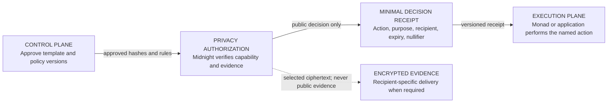
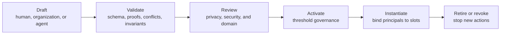
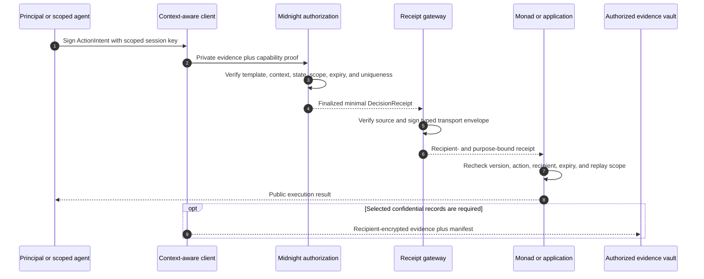
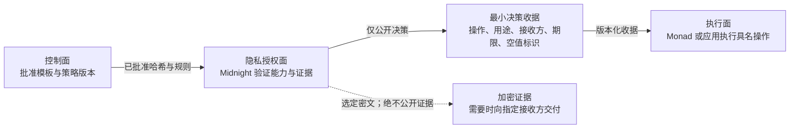
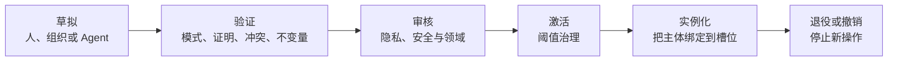

# Permio Programmable Context Architecture

Status: authoritative architecture and implementation contract<br>
Date: 10 October 2026<br>
Scope: versioned scenario templates, context-bound accounts, Midnight privacy authorization, and composable execution

## 1 Decision

Permio is not a fixed review, support, or regulatory application. It is
infrastructure for defining a context, authorizing a narrowly scoped action,
proving only the facts required by that action, and carrying a minimal decision
receipt into an execution system.

The architecture has four independent planes:

1. A **control plane** authors, validates, approves, versions, and retires
   scenario templates and policies.
2. A **privacy authorization plane** evaluates private evidence and
   context-bound capabilities on Midnight.
3. A **high-throughput execution plane** consumes narrow receipts on Monad or
   in an ordinary application without reinterpreting the privacy decision.
4. An **encrypted evidence plane** transports selected confidential records
   directly to an authorized recipient when a proof alone is insufficient.

No architecture component, contract, test, or document may depend on literal
participant names, product names, case identifiers, credential identifiers,
dates, amounts, or other scenario-instance values. Concrete examples and test
fixtures are generated from versioned templates and explicit seeds after a
scenario instance is created.

## 2 Core model

The reusable product unit is a `ScenarioTemplate`. `InformationFlow` is one
runtime action inside a scenario instance.

| Concept | Responsibility | Must not become |
| --- | --- | --- |
| `ScenarioTemplate` | Versioned definition of participant slots, contexts, actions, state transitions, proof requirements, disclosures, and adapters | A bundle of named test participants or instance data |
| `ContextDefinition` | Rules for one social or operational context, including permitted actors, purposes, records, claims, recipients, and transitions | A free-form label with no enforceable semantics |
| `ScenarioInstance` | Runtime binding of one approved template version to actual principals, policy versions, and lifecycle state | A global account role assignment |
| `ContextAccount` | Logical account valid only in one instance or context | A reusable public identity across unrelated contexts |
| `CapabilityGrant` | Authorization for exact actions, resources, purposes, recipients, time, delegation, and disclosure policy | A permanent buyer, merchant, regulator, employee, patient, or agent role |
| `ActionIntent` | Signed request to exercise one capability against current instance state | An implicit permission inferred only from login status |
| `InformationFlow` | Canonical private record of one evaluated action or disclosure | The scenario template or the whole product |
| `DecisionReceipt` | Minimal versioned output stating that one action was approved for one scope | A copy of the source evidence or a universal subject identifier |

The logical relationship is:

```text
ScenarioTemplate + ScenarioInstance + ContextAccount
  + CapabilityGrant + ActionIntent + selected private evidence
  -> InformationFlow evaluation
  -> DecisionReceipt
  -> optional public execution and encrypted evidence delivery
```

## 3 Programmable, context-bound accounts

Registration establishes control of an account key. It does not assign a
business role. Effective authority is derived from active capabilities inside
the selected scenario instance.

```text
CapabilityGrant {
  templateId, templateVersion,
  instanceId, contextId,
  principalRef, sessionPublicKey?,
  actions[], resourceSelector,
  purpose, recipient,
  notBefore, expiresAt,
  disclosurePolicyId,
  delegation: { allowedActions, maxDepth },
  nullifierDomain, revocationRef,
  issuerRef, issuerProof
}
```

Authorization fails closed if any dimension does not match. A correct action
with the wrong context, purpose, recipient, resource, time window, disclosure
policy, delegation depth, or instance is unauthorized.

A session key is a short-lived signing key with a strict subset of a parent
capability. Human users, services, contracts, and automated agents use the same
model. An agent receives permission to perform listed actions, not blanket
access to an account or scenario.

## 4 Architecture views

These diagrams deliberately show one question at a time. Node labels describe
responsibility; edge labels describe the only payload crossing that boundary.

### 4.1 System topology at a glance



The control plane never receives private witness data. The execution plane
never receives enough information to broaden the permission. The encrypted
evidence channel is not routed through either public ledger.

### 4.2 Scenario-template lifecycle



Automated tools may draft, validate, and simulate. They do not create policy
legitimacy. A shared or cross-organization template requires accountable
reviewers and threshold activation of an exact content hash and version.

### 4.3 One runtime action



## 5 Control plane and scenario library

### 5.1 Template contents

Every template version declares:

- stable template identifier, semantic version, namespace, and content hash;
- participant slots and which principals may fill or assign them;
- context definitions and permitted transitions between contexts;
- action schemas, state preconditions, and resulting state transitions;
- capability issuance, attenuation, delegation, expiry, and revocation rules;
- record, claim, recipient, purpose, and disclosure constraints;
- proof/circuit identifiers and expected public-output schemas;
- optional execution adapters and encrypted-evidence requirements;
- migration and retirement rules; and
- executable privacy invariants, negative cases, and acceptance tests.

### 5.2 Who may design and activate scenarios

| Function | Authorized principal | Constraint |
| --- | --- | --- |
| Draft | Human, organization, or agent with a template-author capability | Draft remains private or namespaced |
| Validate and simulate | Deterministic compiler, verifier, and analysis agents | Reports errors and risk; grants no trust |
| Review | Named privacy, security, and domain reviewers | Attests to one template hash and version |
| Activate | Namespace multisig or threshold governance | Sole author cannot self-activate a high-impact template |
| Instantiate | Principal or allocator with an instantiate capability | Only active versions may be used |
| Assign or delegate | Authority declared by the template and current instance | Cannot grant more authority than it holds |
| Retire or revoke | Declared governance or emergency authority | Stops new actions without rewriting historical receipts |

Template namespaces let an organization use local policies without implying
ecosystem-wide trust. Cross-organization templates require governance roots
recognized by every participating namespace.

## 6 Privacy authorization and execution boundary

Midnight decides whether an action is permitted. Monad or an application
executes the permitted public effect. The boundary is a versioned receipt, not
a shared database record.

```text
DecisionReceipt {
  receiptVersion,
  templateId, templateVersion,
  instanceCommitment, contextId,
  actionSchemaId,
  purposeHash, recipient,
  validAfter, validBefore,
  scopedNullifier,
  outputCommitment,
  sourceNetwork, sourceContract, sourceTransaction
}
```

The receipt excludes private evidence, a stable subject identifier, session
keys, credentials, and unrelated instance activity. Its nullifier domain must
include the template, context, action, resource scope, and policy version so it
cannot be reused across purposes.

The execution layer may reject an approved receipt because of local execution
state, but it may not convert it into a broader action. A schema or policy
change requires a new version and explicit compatibility rules.

## 7 Component responsibilities

| Component | Receives | Processes | Emits |
| --- | --- | --- | --- |
| Scenario authoring tools | Draft template and referenced schemas | Editing, simulation, linting | Draft content hash |
| Template validator | Draft, circuit metadata, invariants | Deterministic structural and privacy checks | Validation report |
| Governance registry | Reviewer attestations and activation proposal | Threshold and namespace checks | Active immutable template version |
| Scenario allocator | Active template and instantiate capability | Binds principals to slots | Scenario instance commitment |
| Context-aware client | Instance state, capabilities, private records | Disclosure preview and ActionIntent signing | Private proof request |
| Midnight contract | Proof request and approved template/policy hashes | Capability, evidence, state, and uniqueness verification | Minimal DecisionReceipt fields |
| Gateway | Finalized public Midnight output | Source verification and transport signing | Typed receipt envelope |
| Monad registry or application | Typed receipt | Signer, schema, recipient, expiry, and replay checks | Public action result |
| Evidence vault | Ciphertext and manifest | Recipient decryption and integrity checks | Selected recipient view |

## 8 Required first scenario profiles

These three profiles are part of Permio's architecture and must run through the
same template, capability, privacy-authorization, receipt, and execution model.
They are not embedded fixtures: concrete participants, records, identifiers,
values, dates, and policies are generated or supplied only when a template is
instantiated.

### 8.1 Clinical referral and research consent

A patient can authorize one specialist to access selected observations for a
treatment purpose and limited period. A later research request is a different
context: a research service may receive only an eligibility or cohort claim,
not the treatment record or the specialist relationship. Emergency access, if
supported, is a separately governed action with a short lifetime and an audit
obligation.

This family exercises recipient changes, purpose changes, consent expiry,
revocation, sensitive encrypted evidence, and a deliberate transition from
treatment to research. HL7 FHIR Consent already models recipients, actions,
purposes, data, and effective periods and allows computable consent rules; it is
useful input for a future Permio healthcare profile, not a dependency silently
assumed by the core protocol.

### 8.2 Professional qualification and temporary site access

A credential holder proves that a required qualification is current for one
site, task, and shift without revealing a full transcript, unrelated
certifications, home address, or employment history. A site system issues a
short-lived access capability. If an incident occurs, the holder may authorize
a separate evidence bridge to a named investigator without making the original
presentation globally linkable.

This family exercises issuer authority, credential status and revocation,
selective claims, time-bounded access, and a later investigator context. W3C
Verifiable Credentials materials describe education and professional
qualification use cases, holder-controlled disclosure, duration limits, and
correlation risks; Permio adds context transitions and execution receipts
around those credentials.

### 8.3 Delegated financial or purchasing agent

A person authorizes an automated agent to perform one named transaction or
class of transactions for a named counterparty, bounded resource, purpose,
amount policy, and expiry. The agent cannot inspect unrelated account history,
change the recipient, delegate indefinitely, activate templates, or reuse an
approval after revocation. The privacy plane approves the exact intent; the
execution plane performs the high-volume transaction.

This family exercises machine principals, capability attenuation, monetary or
resource ceilings, explicit counterparties, rapid revocation, and separation of
authorization from execution. OAuth Rich Authorization Requests demonstrates
the need for structured fine-grained authorization details beyond broad scope
strings. ODRL provides another useful policy vocabulary for parties, actions,
assets, constraints, and duties. Permio must profile such ideas rather than
accept arbitrary policy text at runtime.

## 9 Contract authority and governance

“Contract Authority” must not name one permanent manager or one autonomous
program. It combines two responsibilities that must remain distinct:

- a **governance controller** decides which exact issuer, template version,
  policy hash, circuit, verifier, upgrade, or emergency action is authorized;
  and
- an **enforcement contract** automatically verifies the corresponding proof,
  signature, threshold, timelock, and current state.

A single bootstrap secret may exist only in local development and must be
labelled transitional. Production authority is divided into separately scoped
capabilities for template activation, issuer admission, circuit upgrades,
gateway rotation, execution-registry administration, and emergency revocation.
Daily issuers, relayers, agents, and scenario allocators do not hold governance
keys.

## 10 Security and privacy invariants

1. No global public pseudonym links a principal across scenario instances or
   contexts.
2. Every authorization binds template version, instance, context, action,
   resource, purpose, recipient, time, and disclosure policy.
3. Delegation attenuates authority; it never expands it.
4. Review, validation, activation, allocation, and execution are distinct
   capabilities.
5. Agents cannot self-approve templates or obtain blanket account access.
6. Private source records and witness data never enter the gateway, Monad, or a
   public application store.
7. Cross-context disclosure is explicit, purpose-bound, recipient-bound,
   selected-record-bound, expiring, and revocable where the protocol permits.
8. A proof establishes only the claims encoded by its circuit and policy. It
   does not establish that an opinion, allegation, diagnosis, or human judgment
   is true.
9. Template and receipt schema changes are versioned protocol changes.
10. Architecture documents and tests reference generated fixture schemas and
    seeds, never literal scenario-instance data.

## 11 Generated examples and deterministic testing

Concrete scenarios are generated after template selection:

```text
template + generatorVersion + explicitSeed + policyProfile
  -> scenario instance
  -> principals, records, credentials, cases, values, and timestamps
  -> expected private/public classification
  -> positive and negative test vectors
```

The generator must be deterministic for tests, but its output is not protocol
law. Golden vectors record generator version, seed, template hash, and expected
commitments. Changing a generated participant name or instance identifier must
not require architecture, circuit, or application source changes.

Production data is never generated from test seeds. Test output must use
synthetic values and must pass a public-artifact scan proving that fields
classified private are absent from ledgers, receipts, logs, and generated HTML.

## 12 Research basis

- [HL7 FHIR Consent](https://hl7.org/fhir/consent.html) — computable healthcare
  consent with recipients, actions, purposes, data, and periods.
- [W3C Verifiable Credentials Use Cases](https://www.w3.org/TR/vc-use-cases/) —
  education, professional, health, and holder-controlled disclosure examples.
- [W3C Verifiable Credentials Data Model 2.0](https://www.w3.org/TR/vc-data-model-2.0/) —
  credential privacy, selective disclosure, and correlation considerations.
- [RFC 9396: OAuth 2.0 Rich Authorization Requests](https://www.rfc-editor.org/rfc/rfc9396.html) —
  structured fine-grained authorization details.
- [W3C ODRL Information Model 2.2](https://www.w3.org/TR/odrl-model/) — parties,
  actions, assets, constraints, duties, and policy profiles.

These sources inform the required profiles. Permio's profile semantics are
defined by this architecture; adopting an external serialization or runtime
dependency still requires an explicit compatibility decision and tests.

---

# Permio 可编程情境架构

状态：权威架构与实施契约<br>
日期：2026 年 10 月 10 日<br>
范围：版本化情境模板、上下文账户、Midnight 隐私授权与可组合执行

## 1 架构决策

Permio 不是一个固定的评价、客服或监管应用。它是一套用于定义情境、授权有限范围操作、
只证明该操作所需事实，并把最小决策收据交给执行系统的基础设施。

架构包含四个相互独立的平面：

1. **控制面**负责编写、验证、批准、版本化和退役情境模板及策略。
2. **隐私授权面**在 Midnight 上评估私有证据与受上下文约束的能力。
3. **高吞吐执行面**在 Monad 或普通应用中消费狭窄收据，而不重新解释隐私决定。
4. 当证明本身不足时，**加密证据面**把选定机密记录直接交给获授权接收方。

任何架构组件、合约、测试或文档都不得依赖写死的参与者姓名、产品名称、案件标识符、
凭证标识符、日期、金额或其他情境实例值。具体示例和测试数据必须在创建情境实例之后，
根据版本化模板和显式种子生成。

## 2 核心模型

可复用的产品单元是 `ScenarioTemplate`。`InformationFlow` 是情境实例内的一次运行时操作。

| 概念 | 职责 | 不得变成 |
| --- | --- | --- |
| `ScenarioTemplate` | 对参与者槽位、上下文、操作、状态转换、证明要求、披露和适配器进行版本化定义 | 具名测试参与者和实例数据的集合 |
| `ContextDefinition` | 定义一个社会或操作上下文中的参与者、用途、记录、声明、接收方与转换规则 | 没有可执行语义的自由文本标签 |
| `ScenarioInstance` | 把一个已批准模板版本与实际主体、策略版本和生命周期状态绑定 | 全局账户角色分配 |
| `ContextAccount` | 只在一个实例或上下文中有效的逻辑账户 | 在无关上下文之间复用的公开身份 |
| `CapabilityGrant` | 对精确操作、资源、用途、接收方、时间、委托和披露策略进行授权 | 永久买家、商家、监管者、员工、患者或 Agent 角色 |
| `ActionIntent` | 针对当前实例状态行使一个能力的签名请求 | 仅由登录状态隐式推导的权限 |
| `InformationFlow` | 一次经过评估的操作或披露的规范化私有记录 | 情境模板或整个产品 |
| `DecisionReceipt` | 说明一个操作在一个范围内获批准的最小版本化输出 | 来源证据副本或通用主体标识符 |

逻辑关系如下：

```text
ScenarioTemplate + ScenarioInstance + ContextAccount
  + CapabilityGrant + ActionIntent + 所选私有证据
  -> InformationFlow 评估
  -> DecisionReceipt
  -> 可选公开执行与加密证据交付
```

## 3 可编程、受上下文约束的账户

注册只建立账户密钥控制权，不分配业务角色。有效权限由所选情境实例中的活跃能力推导。

```text
CapabilityGrant {
  templateId, templateVersion,
  instanceId, contextId,
  principalRef, sessionPublicKey?,
  actions[], resourceSelector,
  purpose, recipient,
  notBefore, expiresAt,
  disclosurePolicyId,
  delegation: { allowedActions, maxDepth },
  nullifierDomain, revocationRef,
  issuerRef, issuerProof
}
```

任何维度不匹配都必须默认拒绝。即使操作正确，只要上下文、用途、接收方、资源、时间窗口、
披露策略、委托深度或实例不匹配，也不构成授权。

会话密钥是只拥有父能力严格子集的短期签名密钥。人类用户、服务、合约与自动化 Agent
使用同一模型。Agent 只能获得执行列出操作的权限，不能获得账户或情境的全面访问。

## 4 架构视图

下面每张图只回答一个问题。节点描述职责，边描述唯一允许跨越该边界的载荷。

### 4.1 一眼看懂系统拓扑



控制面不接收私有见证数据。执行面不会获得足以扩大权限的信息。加密证据通道不经过任一
公开账本。

### 4.2 情境模板生命周期



自动化工具可以草拟、验证和模拟，但不能赋予策略合法性。共享或跨组织模板需要可问责的
审核者，并通过阈值机制激活精确的内容哈希和版本。

### 4.3 一次运行时操作


## 5 控制面与情境库

### 5.1 模板内容

每个模板版本声明：

- 稳定模板标识符、语义版本、命名空间和内容哈希；
- 参与者槽位以及哪些主体可以填充或分配这些槽位；
- 上下文定义及上下文之间允许的转换；
- 操作模式、状态前置条件及产生的状态转换；
- 能力签发、收缩、委托、到期和撤销规则；
- 记录、声明、接收方、用途和披露约束；
- 证明/电路标识符和预期公开输出模式；
- 可选执行适配器及加密证据要求；
- 迁移和退役规则；以及
- 可执行隐私不变量、负向案例和验收测试。

### 5.2 谁可以设计和激活情境

| 功能 | 获授权主体 | 约束 |
| --- | --- | --- |
| 草拟 | 持有模板作者能力的人、组织或 Agent | 草稿保持私有或只存在于命名空间内 |
| 验证与模拟 | 确定性编译器、验证器和分析 Agent | 报告错误和风险，但不授予信任 |
| 审核 | 具名隐私、安全和领域审核者 | 只为一个模板哈希和版本背书 |
| 激活 | 命名空间多签或阈值治理 | 唯一作者不能自行激活高影响模板 |
| 实例化 | 持有实例化能力的主体或分配器 | 只能使用活跃版本 |
| 分配或委托 | 模板及当前实例声明的权限方 | 不能授予超过自身范围的权限 |
| 退役或撤销 | 声明的治理方或紧急权限方 | 停止新操作，但不改写历史收据 |

模板命名空间允许组织使用本地策略，而不暗示整个生态都信任它。跨组织模板需要每个参与
命名空间都认可的治理根。

## 6 隐私授权与执行边界

Midnight 决定操作是否允许。Monad 或普通应用执行获准的公开效果。两者边界是版本化收据，
而不是共享数据库记录。

```text
DecisionReceipt {
  receiptVersion,
  templateId, templateVersion,
  instanceCommitment, contextId,
  actionSchemaId,
  purposeHash, recipient,
  validAfter, validBefore,
  scopedNullifier,
  outputCommitment,
  sourceNetwork, sourceContract, sourceTransaction
}
```

收据不包含私有证据、稳定主体标识符、会话密钥、凭证或无关实例活动。空值标识域必须包含
模板、上下文、操作、资源范围和策略版本，防止跨用途复用。

执行层可以因为本地执行状态而拒绝一份已批准收据，但不能把它转换为更宽的操作。模式或
策略变更需要新版本和显式兼容规则。

## 7 组件职责

| 组件 | 接收 | 处理 | 输出 |
| --- | --- | --- | --- |
| 情境编写工具 | 模板草稿与引用模式 | 编辑、模拟、lint | 草稿内容哈希 |
| 模板验证器 | 草稿、电路元数据、不变量 | 确定性结构与隐私检查 | 验证报告 |
| 治理注册表 | 审核者背书与激活提案 | 阈值和命名空间检查 | 活跃不可变模板版本 |
| 情境分配器 | 活跃模板与实例化能力 | 把主体绑定到槽位 | 情境实例承诺 |
| 上下文感知客户端 | 实例状态、能力、私有记录 | 披露预览与 ActionIntent 签名 | 私有证明请求 |
| Midnight 合约 | 证明请求与批准的模板/策略哈希 | 验证能力、证据、状态与唯一性 | 最小 DecisionReceipt 字段 |
| 网关 | 已最终确认的 Midnight 公开输出 | 来源验证与传输签名 | 类型化收据封装 |
| Monad 注册表或应用 | 类型化收据 | 验证签名者、模式、接收方、期限与重放 | 公开操作结果 |
| 证据保险库 | 密文与 manifest | 接收方解密及完整性检查 | 选定接收方视图 |

## 8 首批必需情境 profile

这三个 profile 是 Permio 架构的一部分，必须通过同一套模板、能力、隐私授权、收据和执行
模型运行。它们不是嵌入代码的固定测试数据：具体参与者、记录、标识符、数值、日期和策略
只在模板实例化时生成或提供。

### 8.1 临床转诊与研究同意

患者可以授权一位专科人员为了治疗目的、在有限期限内访问选定观察记录。后续研究请求属于
另一个上下文：研究服务只能收到资格或队列声明，不能获得治疗记录或专科关系。如果支持紧急
访问，它必须是一项独立治理、生命周期很短并附带审计义务的操作。

该情境族测试接收方变化、用途变化、同意到期、撤销、敏感加密证据，以及从治疗到研究的
刻意转换。HL7 FHIR Consent 已经建模接收方、操作、用途、数据和有效期，并允许可计算同意
规则；它是 Permio 医疗 profile 的参考，而不是核心协议暗中依赖的组件。

### 8.2 专业资格与临时场地访问

凭证持有人证明某项资格对于一个场地、任务和班次仍然有效，而无需披露完整成绩单、无关证书、
家庭地址或就业历史。场地系统签发短期访问能力。如果发生事件，持有人可以向具名调查者授权
一条独立证据桥接，同时不让原始证明在全局范围内可关联。

该情境族测试签发者权限、凭证状态与撤销、选择性声明、限时访问和后续调查上下文。W3C
Verifiable Credentials 材料描述了教育与专业资格用例、持有人控制披露、期限限制与关联风险；
Permio 在这些凭证之外增加上下文转换和执行收据。

### 8.3 受委托的金融或采购 Agent

一个人授权自动化 Agent 为具名交易对手执行一项具名交易或一类交易，并限制资源、用途、金额
策略和期限。Agent 不能查看无关账户历史、替换接收方、无限委托、激活模板，也不能在撤销后
复用批准。隐私授权面批准精确意图，执行面执行高吞吐交易。

该情境族测试机器主体、能力收缩、金额或资源上限、显式交易对手、快速撤销及授权与执行分离。
OAuth Rich Authorization Requests 展示了为什么需要超越宽泛 scope 字符串的结构化细粒度
授权。ODRL 则为参与方、操作、资产、约束和义务提供了另一套参考词汇。Permio 必须把这些
思想转化为受控 profile，不能在运行时接受任意策略文本。

## 9 合约治理权限

“Contract Authority” 不得表示一个永久 manager，也不得表示一个自主程序。它组合了两项
必须保持分离的职责：

- **治理控制者**决定应当授权哪个精确签发者、模板版本、策略哈希、电路、验证者、升级或
  紧急操作；
- **执行合约**自动验证相应证明、签名、阈值、时间锁和当前状态。

单一引导秘密只能存在于本地开发，并必须标记为过渡方案。生产权限应拆分为模板激活、签发者
准入、电路升级、网关轮换、执行注册表管理和紧急撤销等有限范围能力。日常签发者、中继器、
Agent 和情境分配器都不持有治理密钥。

## 10 安全与隐私不变量

1. 不存在把主体跨情境实例或上下文关联起来的全局公开假名。
2. 每次授权都绑定模板版本、实例、上下文、操作、资源、用途、接收方、时间和披露策略。
3. 委托只能收缩权限，不能扩大权限。
4. 审核、验证、激活、分配和执行是不同能力。
5. Agent 不能自行批准模板，也不能获得账户全面访问。
6. 私有来源记录和见证数据绝不进入网关、Monad 或公开应用存储。
7. 跨上下文披露必须显式、用途绑定、接收方绑定、选定记录绑定、会到期，并在协议允许时可撤销。
8. 证明只建立电路和策略编码的声明，不证明观点、指控、诊断或人的判断为真。
9. 模板和收据模式变更属于版本化协议变更。
10. 架构文档和测试只引用生成器模式与种子，绝不包含写死的情境实例数据。

## 11 生成示例与确定性测试

具体情境在模板选择后生成：

```text
模板 + 生成器版本 + 显式种子 + 策略 profile
  -> 情境实例
  -> 主体、记录、凭证、案件、数值与时间戳
  -> 预期私有/公开分类
  -> 正向与负向测试向量
```

测试生成器必须确定，但其输出不是协议规则。Golden vectors 记录生成器版本、种子、模板哈希
和预期承诺。改变生成的参与者姓名或实例标识符，不得要求修改架构、电路或应用源码。

生产数据绝不使用测试种子生成。测试输出必须使用合成值，并通过公开产物扫描，证明被分类为
私有的字段没有出现在账本、收据、日志或生成 HTML 中。

## 12 研究依据

- [HL7 FHIR Consent](https://hl7.org/fhir/consent.html)——包含接收方、操作、用途、数据和期限
  的可计算医疗同意。
- [W3C Verifiable Credentials Use Cases](https://www.w3.org/TR/vc-use-cases/)——教育、专业、
  医疗及持有人控制披露示例。
- [W3C Verifiable Credentials Data Model 2.0](https://www.w3.org/TR/vc-data-model-2.0/)——
  凭证隐私、选择性披露和关联风险。
- [RFC 9396: OAuth 2.0 Rich Authorization Requests](https://www.rfc-editor.org/rfc/rfc9396.html)——
  结构化细粒度授权详情。
- [W3C ODRL Information Model 2.2](https://www.w3.org/TR/odrl-model/)——参与方、操作、资产、
  约束、义务和策略 profile。

这些资料用于定义必需 profile。Permio 的 profile 语义由本架构确定；采用外部序列化格式或
运行时依赖仍然需要明确的兼容性决策与测试。
